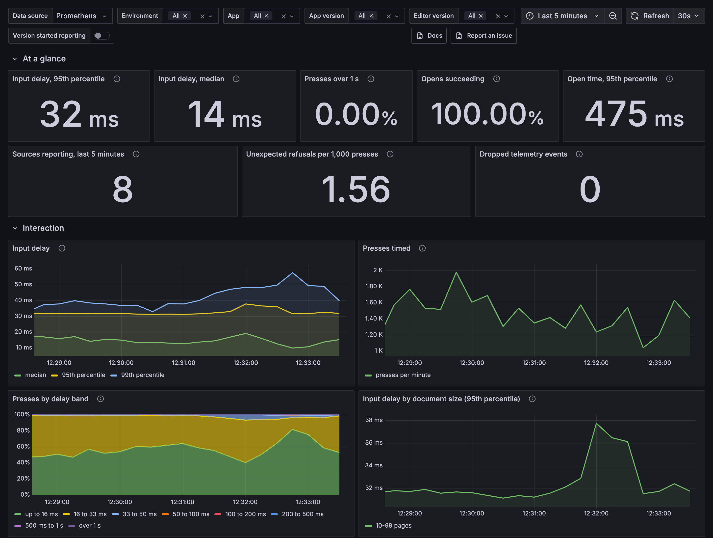
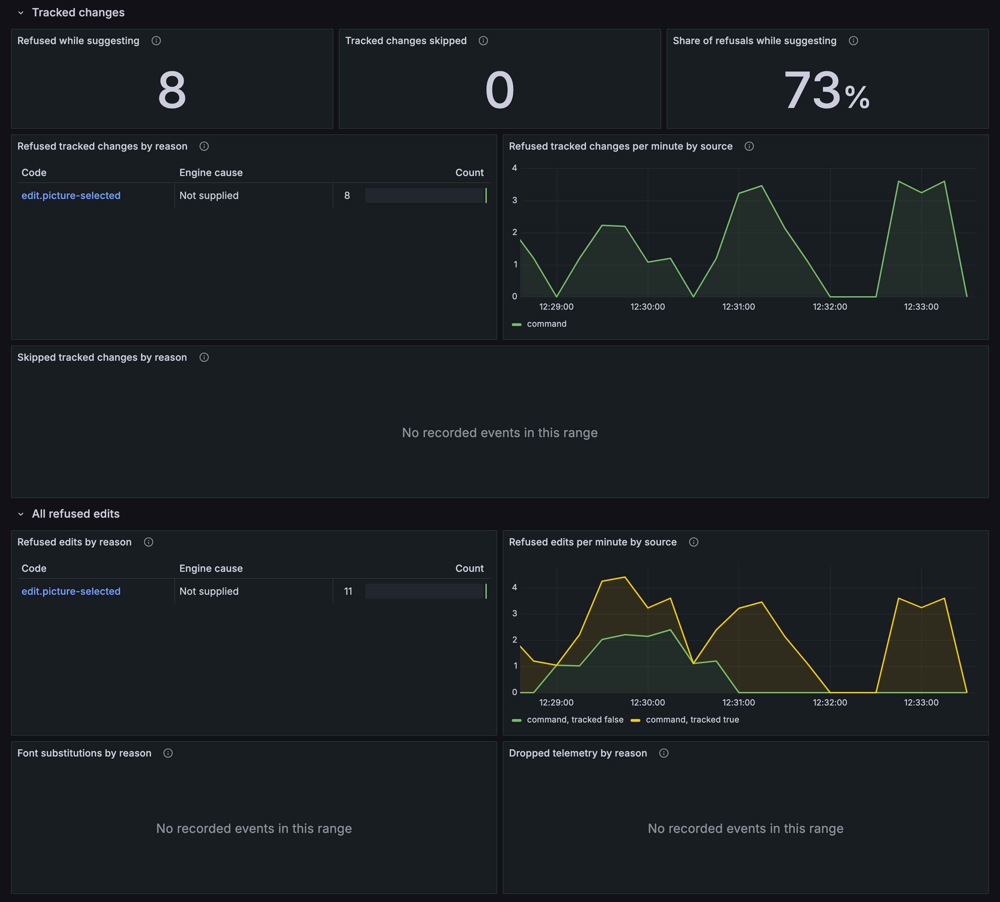
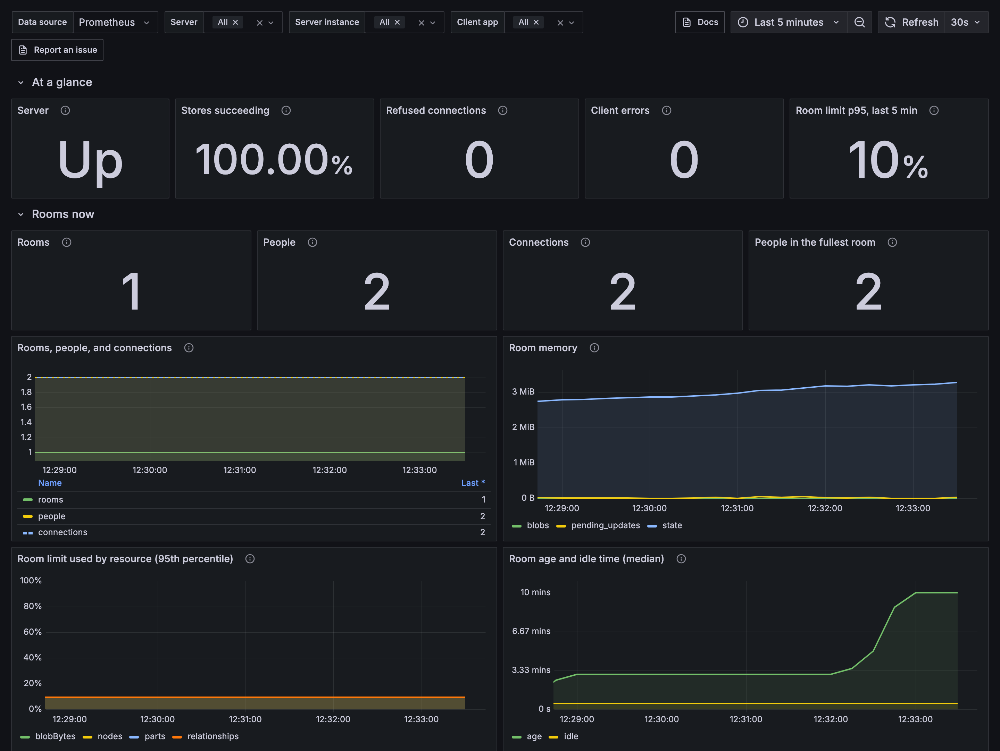

# Observability assets

Import these Grafana dashboards to monitor editor performance and collaboration servers with `@docx-editor.dev/telemetry`.

The dashboards report measurements without setting targets. Use several weeks of your own traffic to set performance targets and alert thresholds.



## Download

| File | What it is | Download |
| --- | --- | --- |
| [`grafana/editor-experience.json`](grafana/editor-experience.json) | **Editor experience**: input delay, engine layout and paint time, opens, refused and skipped tracked changes, and all refused edits by code, filtered by environment, app, app version, and editor version. | [Raw file](https://raw.githubusercontent.com/eigenpal/docx-editor/main/assets/observability/grafana/editor-experience.json) |
| [`grafana/collaboration.json`](grafana/collaboration.json) | **Collaboration**: server state, rooms and people, room memory and limits, room load and store time, client status, and refused connections and messages. | [Raw file](https://raw.githubusercontent.com/eigenpal/docx-editor/main/assets/observability/grafana/collaboration.json) |
| [`generate.py`](generate.py) | Generates the dashboard JSON files. |  |

To download both dashboards from a terminal, run:

```bash
BASE=https://raw.githubusercontent.com/eigenpal/docx-editor/main/assets/observability
curl -LO "$BASE/grafana/editor-experience.json"
curl -LO "$BASE/grafana/collaboration.json"
```

## Import the dashboards

1. In Grafana, go to **Dashboards** > **New** > **Import**, and upload a JSON file.
2. Open the dashboard, and select your Prometheus data source in **Data source**.
3. Select the **App** and **Environment** values. On the collaboration dashboard, select the **Server** job and its instances.

The dashboards read the Prometheus names in the [metrics reference](https://docx-editor.dev/docs/2.x/telemetry/metrics). Editor metrics reach Prometheus from browsers through your OpenTelemetry SDK and an OpenTelemetry Protocol (OTLP) collector. Server metrics come from the `/metrics` endpoint of your collaboration server.

The filters use these labels:

| Label | Comes from |
| --- | --- |
| `job` | `service.name` on your OpenTelemetry SDK, or the scrape job of your server. |
| `deployment_environment` | `deployment.environment`, which you add with `attributes` and `metricLabels`. |
| `app_version` | `app.version`, which you add with `attributes` and `metricLabels`. |
| `docx_editor_version` | Added by the telemetry package to every editor metric. |
| `docx_editor` | The scrape target label that marks a collaboration server. |

```ts
import { createTelemetry } from '@docx-editor.dev/telemetry';
import { otelExporter } from '@docx-editor.dev/telemetry/otel';

export const telemetry = createTelemetry({
  exporters: [otelExporter()],
  include: {
    documentOpen: true,
    editing: true,
    trackedChanges: true,
    fonts: true,
    performance: true,
    // Only in apps with collaboration: the client panels of the Collaboration dashboard.
    collaborationClient: true,
  },
  attributes: { 'deployment.environment': 'production', 'app.version': '4.2.0' },
  metricLabels: ['deployment.environment', 'app.version'],
});
```

## Editor experience

The summary shows input delay and editing reliability. Detailed charts compare input delay over time and across document sizes, app versions, and editor versions. Other panels show layout and paint times, document opens, refused files, refused and skipped tracked changes, and refused edits. Each refusal code links to its hint.



Input delay percentiles are estimates from the timing bands. A percentile of 1 second indicates a value in the band above 1 second. In that case, read **Presses over 1 s**.

## Collaboration

The summary shows server availability, room save success rates, refused connections, client errors, and room limit usage. Detailed charts show room and participant counts, memory use, room age, server operations, client status, and refusals.



The people totals add up all selected server instances. If your instances share rooms through Redis, select one instance. Each instance counts the same participants.

## Mark collaboration servers

The server panels of the **Collaboration** dashboard read only targets with the `docx_editor="collaboration"` label. Add it to the scrape configuration of each collaboration server. This excludes other targets in the same job. Servers still appear when every scrape fails. The client panels read the editor metrics, and only the **Client app** filter applies to them:

```yaml
scrape_configs:
  - job_name: collaboration-server
    static_configs:
      - targets: ['collaboration.internal:1235']
        labels:
          docx_editor: collaboration
```

## Try them locally

[`examples/telemetry-stack`](../../examples/telemetry-stack) runs an OpenTelemetry collector, Prometheus, Jaeger, and Grafana with these dashboards, and simulates people who edit.

## Change the dashboards

Edit `generate.py`, then run:

```bash
python3 assets/observability/generate.py
bun run format
```

To refresh the screenshots, run the local stack and its simulation, then run `node assets/observability/screenshots/capture.mjs`, which writes to `docs/site/content/telemetry/images/` from the repository root.

For setup and options, see [Dashboards](https://docx-editor.dev/docs/2.x/telemetry/dashboards) in the telemetry docs. To report a problem, [open an issue](https://github.com/eigenpal/docx-editor/issues/new/choose).
