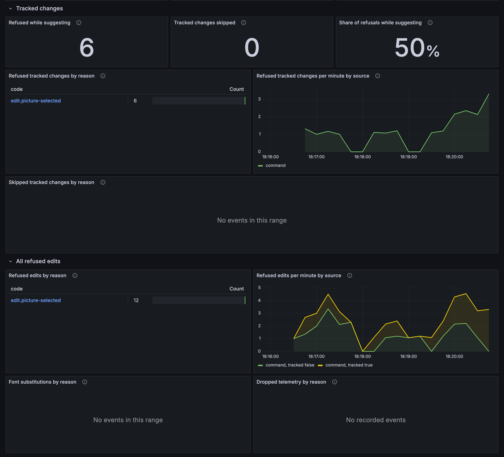

# Observability assets

Grafana dashboards for `@docx-editor.dev/telemetry`. Import them into your own Grafana to see how editing feels to your users and how your collaboration server runs.

The dashboards report measurements only and set no targets. Decide what is acceptable from a few weeks of your own traffic, then decide what to alert on.


## Download

| File | What it is | Download |
| --- | --- | --- |
| [`grafana/editor-experience.json`](grafana/editor-experience.json) | **Editor experience**: input delay, engine layout and paint time, opens, refused and skipped tracked changes, and all refused edits by code, filtered by environment, app, app version, and editor version. | [Raw file](https://raw.githubusercontent.com/eigenpal/docx-editor/main/assets/observability/grafana/editor-experience.json) |
| [`grafana/collaboration.json`](grafana/collaboration.json) | **Collaboration**: server state, rooms and people, room memory and limits, room load and store time, client status, and refused connections and messages. | [Raw file](https://raw.githubusercontent.com/eigenpal/docx-editor/main/assets/observability/grafana/collaboration.json) |
| [`generate.py`](generate.py) | Generates every file above. |  |

To download both dashboards from a terminal, run:

```bash
BASE=https://raw.githubusercontent.com/eigenpal/docx-editor/main/assets/observability
curl -LO "$BASE/grafana/editor-experience.json"
curl -LO "$BASE/grafana/collaboration.json"
```

## Import the dashboards

1. In Grafana, go to **Dashboards** > **New** > **Import**, and upload a JSON file.
2. Open the dashboard, and select your Prometheus data source in **Data source**.
3. Select the **App** and **Environment** values. On the collaboration dashboard, select the **Server** job and its instances.

The dashboards read the Prometheus names in the [metrics reference](https://docx-editor.dev/docs/2.x/telemetry/metrics). Editor metrics reach Prometheus from browsers through your OpenTelemetry SDK and an OpenTelemetry Protocol (OTLP) collector. Server metrics come from the `/metrics` endpoint of your collaboration server.

The filters use these labels:

| Label | Comes from |
| --- | --- |
| `job` | `service.name` on your OpenTelemetry SDK, or the scrape job of your server. |
| `deployment_environment` | `deployment.environment`, which you add with `attributes` and `metricLabels`. |
| `app_version` | `app.version`, which you add with `attributes` and `metricLabels`. |
| `docx_editor_version` | Added by the telemetry package to every editor metric. |
| `docx_editor` | The scrape target label that marks a collaboration server. |

```ts
import { createTelemetry } from '@docx-editor.dev/telemetry';
import { otelExporter } from '@docx-editor.dev/telemetry/otel';

export const telemetry = createTelemetry({
  exporters: [otelExporter()],
  include: {
    documentOpen: true,
    editing: true,
    trackedChanges: true,
    fonts: true,
    performance: true,
    // Only in apps with collaboration: the client panels of the Collaboration dashboard.
    collaborationClient: true,
  },
  attributes: { 'deployment.environment': 'production', 'app.version': '4.2.0' },
  metricLabels: ['deployment.environment', 'app.version'],
});
```

## Editor experience

The first row shows how editing feels now. The rows below show input delay over time and by document size, app version, and editor version; engine layout and paint time; opens and refused files; refused and skipped tracked changes; and all refused edits, each code linked to its hint.



Input delay percentiles are estimates from the timing bands. The highest band ends at 1 second, so a percentile of 1 second means that it falls in the over 1 second band. In that case, read **Presses over 1 s**.

## Collaboration

The first row shows whether the server answers, the share of room stores that succeed, refused connections, client errors, and room limit usage. The rows below show rooms and people, memory, room age, server work, client status, and refusals.


The people totals add up all selected server instances. If your instances share rooms through Redis, each instance counts the same people, so select one instance.

## Mark collaboration servers

The server panels of the **Collaboration** dashboard read only targets with the `docx_editor="collaboration"` label. Add it to the scrape configuration of each collaboration server. Other targets in the same job then never appear, and a server that fails every scrape still shows. The client panels read the editor metrics, and only the **Client app** filter applies to them:

```yaml
scrape_configs:
  - job_name: collaboration-server
    static_configs:
      - targets: ['collaboration.internal:1235']
        labels:
          docx_editor: collaboration
```

## Try them locally

[`examples/telemetry-stack`](../../examples/telemetry-stack) runs an OpenTelemetry collector, Prometheus, Jaeger, and Grafana with these dashboards, and simulates people who edit.

## Change the dashboards

Edit `generate.py`, then run:

```bash
python3 assets/observability/generate.py
bun run format
```

To refresh the screenshots, run the local stack and its simulation, then run `node assets/observability/screenshots/capture.mjs` from the repository root.

For setup and options, see [Dashboards](https://docx-editor.dev/docs/2.x/telemetry/dashboards) in the telemetry docs. To report a problem, [open an issue](https://github.com/eigenpal/docx-editor/issues/new/choose).
