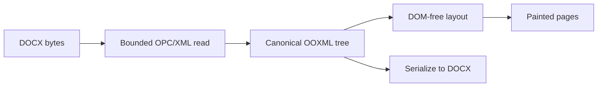

The engine has one document model and one pipeline. The canonical OOXML tree owns document state; everything else is a projection of it.

## Choose an engine entry point

| Goal                             | Import                                                |
| -------------------------------- | ----------------------------------------------------- |
| Create and mount an editor       | `createDocxEditor` from `@docx-editor.dev/core`       |
| Build an adapter                 | `@docx-editor.dev/core/editor`                        |
| Read or write the canonical tree | `@docx-editor.dev/core/store`                         |
| Lay out pages without a DOM      | `@docx-editor.dev/core/layout`                        |
| Automate documents on a server   | [`@docx-editor.dev/editor-api`](/docs/2.x/editor-api) |

For the full subpath table, see [Core package overview](/docs/2.x/core#choose-an-import).

## Follow the document pipeline

Each document moves through one direction:

Edits go back into the tree as transactions. Layout and paint then run again for the changed blocks.

## Respect package boundaries

| Boundary | Owns | Must not own |
| --- | --- | --- |
| `contracts` | Public engine types and interfaces | Runtime implementation or state |
| `store` | Canonical trees, package reads and writes, indexes, and transactions | DOM or ProseMirror state |
| `layout` | DOM-free pagination and interaction geometry, in points | Browser layout or authored state |
| `output` | Painted pages from layout records | Document mutation |
| `binding` | The ProseMirror projection and conversion of edits into tree operations | Document state |
| `automation` | Transport-neutral operations for browser and server automation | DOM or editor chrome |
| `editor` | The editor facade, surface input, caret, and chrome registry | A second document model |
| `react` and `vue` | Providers, hooks or composables, and framework chrome | Editing state |

## Understand editing and saving

- **One source of truth.** The canonical tree owns document state. The painted DOM and the ProseMirror projection do not.
- **Painted pages are the surface.** The pages are `contenteditable`, but the engine prevents browser mutations and re-expresses them as tree operations.
- **One write path.** Every edit is a transaction addressed by node id and character offset. Package operations, such as creating a header, address a section index. Undo, commands, and the editing API share this path.
- **Typed and generic nodes.** Paragraphs, runs, and tables are typed. Other elements stay as lossless generic nodes. A known element in an invalid position becomes generic.
- **Unknown content never blocks editing.** A document with unrecognized extensions opens, accepts edits, and saves.
- **Incremental layout.** Per-block cache keys and flow checkpoints limit work to changed content. A pass with no change returns the previous pages by identity.
- **Structural preservation.** Saving re-emits each parsed XML part from the tree, including custom XML and unknown extensions. Modeled XML re-emits normalized; only non-XML parts, such as media and embedded fonts, keep byte identity.

## Limits

- Applications must resolve one copy of `@docx-editor.dev/core`. Both adapters take it as a peer dependency.
- Preservation of generic content does not mean the engine renders it. For rendering support, see [DOCX fidelity](/docs/2.x/docx-fidelity).

## See also

- [Core package overview](/docs/2.x/core)
- [DOCX fidelity](/docs/2.x/docx-fidelity)
- [Editor mount modes](/docs/2.x/core/mount-modes)
