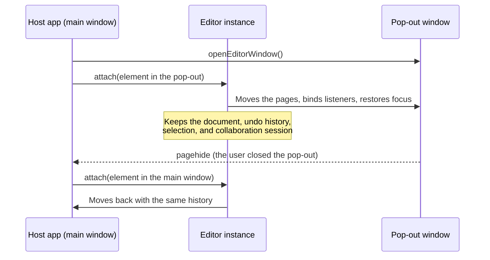

You can show the editor in a pop-out window, a same-origin iframe, or any other document than the one your script runs in. You can also move a mounted editor between windows. The editor keeps its document, undo history, selection, scroll position, and collaboration session across each move, and the keyboard focus follows it.

## Pop out the editor in React

For a runnable app, see the [pop-out window example](https://github.com/eigenpal/docx-editor/tree/main/examples/popout-window).

Wrap the parts to pop out in `DocxEditor.Window`. While `open` is `true`, it renders them in a pop-out window that has your page's stylesheets. When `open` is `false`, they render in place. Keep `DocxEditor.Root` outside `DocxEditor.Window`, so the editor instance stays in the main window.

The following example adds a **Pop out** button that moves the toolbar and the pages into their own window:

```tsx
import { useState } from 'react';
import { DocxEditor } from '@docx-editor.dev/react';

export function Editor({ bytes }: { bytes: Uint8Array }) {
  const [popped, setPopped] = useState(false);
  return (
    <DocxEditor.Root document={bytes}>
      <button onClick={() => setPopped(!popped)}>{popped ? 'Bring back' : 'Pop out'}</button>
      <DocxEditor.Window open={popped} onClose={() => setPopped(false)}>
        <DocxEditor.Toolbar />
        <DocxEditor.Viewport style={{ height: '100%' }}>
          <DocxEditor.Content />
        </DocxEditor.Viewport>
      </DocxEditor.Window>
    </DocxEditor.Root>
  );
}
```

When the user closes the pop-out, the panel comes back before the window's document unloads, and `onClose` runs. Call `window.open` only from a user gesture, such as the button click in the example. If the browser blocks the window, the panel stays in place and `onClose` runs.

Do not wrap the `<DocxEditor>` component in a pop-out yourself. It owns its editor instance, so unmounting it destroys the instance and its undo history. Use the composition API, as in the example. For more information, see [React composition](/docs/2.x/react/composition).

## Pop out the editor in Vue

Wrap the parts to pop out in `DocxEditorWindow`, and bind `v-model:open`. When the user closes the pop-out, the panel comes back and `open` becomes `false`.

The following example adds a **Pop out** button that moves the toolbar and the pages into their own window:

```vue
<script setup lang="ts">
import { ref } from 'vue';
import {
  DocxEditorContent,
  DocxEditorRoot,
  DocxEditorToolbar,
  DocxEditorViewport,
  DocxEditorWindow,
} from '@docx-editor.dev/vue';

defineProps<{ bytes: Uint8Array }>();
const popped = ref(false);
</script>

<template>
  <DocxEditorRoot :document="bytes">
    <button @click="popped = !popped">
      {{ popped ? 'Bring back' : 'Pop out' }}
    </button>
    <DocxEditorWindow v-model:open="popped">
      <DocxEditorToolbar />
      <DocxEditorViewport style="height: 100%">
        <DocxEditorContent />
      </DocxEditorViewport>
    </DocxEditorWindow>
  </DocxEditorRoot>
</template>
```

`DocxEditorWindow` remounts the content on each move, which is what moves the editor. If you build your own pop-out with a `Teleport`, switch between a `Teleport` and the inline panel with `v-if` rather than changing the `to` target of one `Teleport`. A retargeted `Teleport` moves the DOM without a remount: the pages notice their new window when the pointer reaches them or they get focus, but a popover that is open at that moment keeps listening to the old window until it closes.

## Pop out the editor without an adapter

Use `openEditorWindow` to open the pop-out, and move the editor with `attach`. The following example moves an editor into a pop-out and back when the pop-out closes:

```ts
import { createDocxEditor, openEditorWindow } from '@docx-editor.dev/core/editor';

declare const bytes: Uint8Array;
const home = document.getElementById('editor')!;
const editor = createDocxEditor({ document: bytes, container: home });

async function popOut() {
  const popup = await openEditorWindow({ title: 'Contract' });
  if (!popup) return; // The browser blocked the window.
  editor.attach(popup.element);
  popup.onClose(() => editor.attach(home));
}
```

`openEditorWindow` resolves to an `EditorWindow` with these members:

- `element`: the mount point, which fills the window.
- `onClose(listener)`: runs once when the window goes away, while its document still exists.
- `close()`: closes the window and runs the `onClose` listeners.

The window closes when your page unloads.

## Window options

`DocxEditor.Window`, `DocxEditorWindow`, and `openEditorWindow` take the same window options:

| Option | Default | Description |
| --- | --- | --- |
| `url` | `about:blank` | A same-origin page to open, such as an empty HTML file that your app serves. |
| `name` | `docx-editor` | The window name. Two windows with the same name share one browser window, so give each editor its own name. |
| `features` | `popup,width=1000,height=900` | The `window.open` features string. Set the window size and position here. |
| `title` | None | The title of the pop-out. |
| `styles` | `true` | Copy your page's stylesheets into the window and keep them current. Pass `false` to style the window yourself, or a function that copies them and returns a stop function. |

## Use a window that your app opens

If your app already opens its own windows, for example as part of a docking or panel layout, you do not need the window helpers. Keep the editor root mounted in the main window, and render the content into an element in your window. When that element changes, the content unmounts in one window and mounts in the other, and the editor moves with its history.

The following example renders the editor panel into an element that your panel system provides:

```tsx
import { createPortal } from 'react-dom';
import { DocxEditor } from '@docx-editor.dev/react';

function EditorPanel() {
  return (
    <div className="docx-editor" style={{ height: '100%' }}>
      <DocxEditor.Toolbar />
      <DocxEditor.Viewport style={{ height: '100%' }}>
        <DocxEditor.Content />
      </DocxEditor.Viewport>
    </div>
  );
}

// `panelHost` is an element in your pop-out window, or null when the
// panel is docked in the main window.
type EditorProps = {
  bytes: Uint8Array;
  panelHost: HTMLElement | null;
};

export function Editor(props: EditorProps) {
  const panel = <EditorPanel />;
  return (
    <DocxEditor.Root document={props.bytes}>
      {props.panelHost ? createPortal(panel, props.panelHost) : panel}
    </DocxEditor.Root>
  );
}
```

In this case, your app copies the stylesheets into its window. Call `copyEditorStyles(document, popup.document)` once, and call the function it returns when the window closes. When the user closes your window, render the panel in the main window again inside the window's `pagehide` event, with `flushSync` in React, so that the editor moves before the window's document unloads.

## How a move works

For more information about every place an editor can live, see [Editor mount modes](/docs/2.x/core/mount-modes).

The editor finds its window from the element that you attach it to. Focus, selection, scrolling, resizing, pointer drags, timers, observers, the clipboard, and the fonts that the editor registers all use that window. The editor does not use the global `document` or `window` of your script.



- `attach(element)` moves an open document into `element`. This works from another element, from another window, or after `detach()`. If the pages had the keyboard focus before the move, they get it again. Pass `{ focus: false }` as the second argument to leave the focus where it is.
- `detach()` keeps the document and all editing state for the next `attach()`. While detached, the editor still saves, runs commands, and receives collaboration edits. It paints when you attach it again.
- `destroy()` releases the editor. Call it when you no longer need the editor.

The adapters call `attach` and `detach` when the content component mounts and unmounts: `DocxEditor.Content` in React and `DocxEditorContent` in Vue.

## Prepare the other window

`openEditorWindow` and the adapter components prepare the pop-out for you:

- **Styles.** They copy your page's `<link>` and `<style>` stylesheets, constructed stylesheets, and the theme attributes on `<html>`, such as `class` and `data-theme`, and they keep the copy current while the window is open. Stylesheets that your page adds, changes, or removes later follow. Rules that a CSS-in-JS library inserts into a `<style>` element through the CSSOM follow within a fraction of a second. Rules inserted into a `<link>` stylesheet, and stylesheets from another origin, are not copied. Pass `styles: false` to style the window yourself, or call `copyEditorStyles(from, to)` for a window that you open yourself.
- **Fonts.** The editor registers the document's embedded fonts and your configured fonts in the new window. Web fonts that your stylesheets load come with the copied styles.
- **Same origin.** The pop-out opens `about:blank` by default. To open a page that your app serves, such as an empty HTML file, pass `url`. A served page has its own address, which some browser extensions and automation tools need. A cross-origin page does not work, because the browser blocks scripts from rendering into it.

## Build custom chrome that works in any window

Custom chrome that listens on the document, reads focus, measures the viewport, or uses the clipboard must use the editor's window:

| Need | Use |
| --- | --- |
| The document or window of an element that your component renders | `hostDocumentOf(element)`, `hostWindowOf(element)` |
| The document or window that the editor is mounted in | `editorHostDocument(editor)`, `editorHostWindow(editor)` |
| The element that the editor is mounted in | `editorHostElement(editor)` |
| Timers and frames that follow the editor's window | `hostTimers(() => element)` |
| A reactive value in React or Vue | `useEditorHostDocument()`; its `defaultView` is the window |
| A notification when the editor changes documents | `editor.on('hostChange', ({ document }) => ...)` |
| A type check for an element or event from any window | `isElementNode`, `isHTMLElementNode`, `isKeyboardEvent`, `isPointerEvent` |

The hooks come from `@docx-editor.dev/react` and `@docx-editor.dev/vue`. The other helpers come from `@docx-editor.dev/core/editor`. A check such as `node instanceof HTMLElement` is `false` for an element of another window, so use the type checks instead.

The following example copies text to the clipboard of the window that the editor is in:

```ts
import type { Editor } from '@docx-editor.dev/core';
import { editorHostWindow } from '@docx-editor.dev/core/editor';

async function copyText(editor: Editor, text: string) {
  // The clipboard of the editor's window: the pop-out while it is there.
  await editorHostWindow(editor).navigator.clipboard.writeText(text);
}
```

## Limits

- A detached editor keeps its document and layout in memory. Call `destroy()` to release them.
- `load()` while the editor is detached replaces the kept document.
- When the content remounts in another window, popovers and menus inside it close.
- The context menu's **Paste** command reads the clipboard, which needs the clipboard-read permission. The browser asks for it once per origin. Keyboard paste (Ctrl+V or Cmd+V) needs no permission.
- The editor's timers run on the window that it is in. If the main window is minimized or hidden, typing in the pop-out is not delayed. Code of your own that runs in the main window still follows that window's timer throttling.
