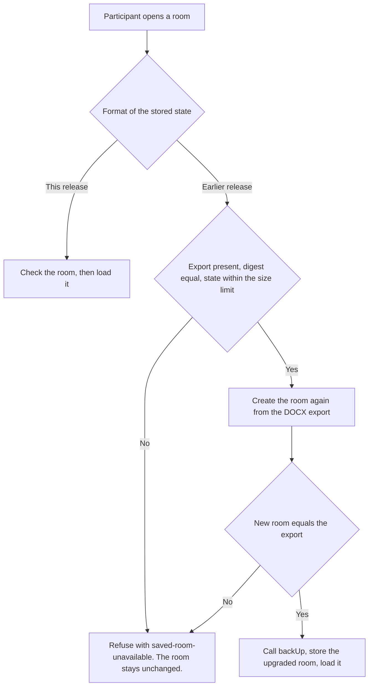

`collaborationServerExtension` does the room's part of a Hocuspocus server. Add it to `extensions`, and write two things: an access check and a storage adapter.

| You write | The extension does |
| --- | --- |
| `onAuthenticate`: who can open which room | Refuses clients of another collaboration format |
| `storage.load` and `storage.save`: where room bytes are | Checks each stored room before it becomes the live room |
| `storage.backUp`, optional | Stores each room with a DOCX export |
| `createRoom`, optional | Upgrades a stored room when the collaboration format changes |

For every option and limit, see [Run a room server](/docs/2.x/pro/collaboration#run-a-room-server).

## Quickstart

### 1. Install

The Hocuspocus v4 server runs on Node.js, not on Bun.

```bash
npm install @docx-editor.dev/pro yjs @hocuspocus/server
```

### 2. Add storage for three values

Each room has a state, a DOCX export, and the SHA-256 digest of the exported state. For example, in SQL:

```sql
create table rooms (
  name    text primary key,
  state   bytea not null,
  docx    bytea,          -- The export. Null until the first export.
  digest  text,           -- The digest that arrived with `docx`.
  previous bytea          -- The state before the last upgrade.
);
```

### 3. Write the server

```ts
import { Server } from '@hocuspocus/server';
import {
  collaborationServerExtension,
  type CollaborationRoomStorage,
} from '@docx-editor.dev/pro/collaboration';

// Your database client and your access check.
interface RoomRow {
  state: Uint8Array;
  docx: Uint8Array | null;
  digest: string | null;
}
declare const db: { query(sql: string, values: unknown[]): Promise<RoomRow[]> };
declare function verifyDocumentAccess(token: string, roomName: string): Promise<void>;

const storage: CollaborationRoomStorage = {
  async load(name) {
    const [room] = await db.query('select state, docx, digest from rooms where name = $1', [name]);
    if (!room) return null;
    const exported =
      room.docx && room.digest ? { docx: room.docx, stateDigest: room.digest } : null;
    return { state: room.state, export: exported };
  },

  async save(name, { state, export: exported }) {
    // `exported` is null when this store has no new export: keep the stored one.
    await db.query(
      `insert into rooms (name, state, docx, digest) values ($1, $2, $3, $4)
       on conflict (name) do update set
         state = excluded.state,
         docx = coalesce(excluded.docx, rooms.docx),
         digest = coalesce(excluded.digest, rooms.digest)`,
      [name, state, exported?.docx ?? null, exported?.stateDigest ?? null]
    );
  },

  async backUp(name, state) {
    await db.query('update rooms set previous = $2 where name = $1', [name, state]);
  },
};

const server = new Server({
  port: 1234,
  async onAuthenticate({ token, documentName }) {
    await verifyDocumentAccess(token, documentName);
  },
  extensions: [
    collaborationServerExtension({
      storage,
      onEvent: (event) => console.log(JSON.stringify(event)),
    }),
  ],
});
await server.listen();
```

Write the state and the export in one statement, as the sample does. If your storage cannot, write the state first.

### 4. Connect the client

The client needs no server-specific code. The hook sends the collaboration format to the server:

```tsx
const { document, modules, session, error } = useHocuspocusCollaboration({
  room: {
    url: 'wss://collab.example.test',
    roomId,
    token,
    identity: { actorId, name },
    bootstrap: { kind: 'create-or-join', document: bytes },
  },
});
```

For the full component, see [Connect to a Hocuspocus server](/docs/2.x/pro/collaboration#connect-to-a-hocuspocus-server).

## Move an existing server to the extension

1. Deploy clients of a release that has the extension. A server with the extension refuses clients that send no `collaborationFormat` parameter. If you cannot update all clients first, see [Admit earlier clients during a rollout](/docs/2.x/pro/collaboration#admit-earlier-clients-during-a-rollout).
1. Add the export and the digest to your room storage.
1. Write `load`, `save`, and `backUp` as the quickstart shows.
1. Remove your own room code, as the following table lists.
1. Deploy the server on the same release and collaboration format as before.

| Your code | Action |
| --- | --- |
| Format check in `onAuthenticate`, and the token envelope for the version | Remove. Keep your access check. |
| `prepareCollaborationServerDocument` in `onLoadDocument` | Remove. |
| Saved-room check and `Y.applyUpdate` in `onLoadDocument` | Remove. `storage.load` returns the bytes. |
| `document.flush()` in `afterLoadDocument` | Remove. |
| `checkCollaborationRoomGeneration` in `beforeHandleMessage` | Remove. |
| `onStoreDocument` | Remove. `storage.save` receives the bytes. |
| `createCollaborationState` for a room that storage does not hold | Move to the `createRoom` option. |
| `compactCollaborationState` on load | Replace with `compactOnLoad: true`. |

Stored rooms need no conversion. A room gets its export when the server first loads or stores it. For rooms that nobody opens, run [Export existing rooms once](/docs/2.x/pro/collaboration-versions#export-existing-rooms-once).

## Deploy a release that changes the format

Most releases keep the collaboration format, and you deploy them as any other release. To know before you deploy, compare `format` for the two releases in the [release data](/docs/2.x/pro/collaboration-versions#read-the-release-table-as-data).

When the formats differ:

1. Ask users with unsent offline edits to reconnect. Pending edits do not transfer to an upgraded room.
1. Stop every room server of the earlier release.
1. Deploy the clients and the room servers of the target release together.
1. Watch `onEvent` for `room-upgraded` and `room-upgrade-refused`.

In Kubernetes, the `Recreate` strategy stops the earlier servers first:

```yaml
spec:
  strategy:
    type: Recreate
```

You install no earlier release and run no migration job. The server does the following when the first participant opens a room:



The room keeps its ID and its links. Collaboration undo history starts afresh.

## Monitor rooms

`onEvent` receives a typed object for each action. Events hold codes, part names, and positions, never document text.

```ts
import type { CollaborationServerEvent } from '@docx-editor.dev/pro/collaboration';

declare const metrics: { count(name: string, labels: Record<string, string>): void };

export function onEvent(event: CollaborationServerEvent): void {
  const reason = event.type === 'room-upgrade-refused' ? event.reason : '';
  metrics.count('collaboration_room_events', { type: event.type, reason });
  if (event.type !== 'room-upgraded') console.warn(JSON.stringify(event));
}
```

| Event `type` | Meaning | Action |
| --- | --- | --- |
| `room-upgraded` | The server upgraded a stored room. | None, when `hidden` is 0. |
| `room-upgrade-refused` | The server did not upgrade a room of an earlier format. | See the next table. |
| `room-load-refused` | The stored room is of a later format, or it forms no document. | Serve it with the release that wrote it, or restore it. |
| `room-export-failed` | The room does not export, so the server did not store it. | Check `code`. Storage keeps the last room that exported. |
| `room-compaction-failed` | A compaction on load failed. The room loaded as stored. | Check `code`. |

A refused upgrade leaves the room unchanged in storage. `reason` says why:

| `reason` | Cause | Action |
| --- | --- | --- |
| `no-export` | Storage holds no export of the room. | Migrate the room in a job. |
| `stale-export` | The server stopped before it exported the last state. | Migrate the room in a job. |
| `too-large` | The state is larger than `maxUpgradeStateBytes`, 64 MiB by default. | Migrate the room in a job, or raise the limit. |
| `check-failed` | The upgraded room differs from the export. | Read `changedParts` in the event, and report the defect. |
| `error` | The state or the export cannot be read. | Act on `code`. |
| `disabled` | `upgradeOnLoad` is `false`. | Migrate the room in a job. |

The job exports each room with the earlier release and migrates it with the target release. See [Migrate rooms on a server](/docs/2.x/pro/collaboration-versions#migrate-rooms-on-a-server).

## Troubleshoot a refused client

The client reports the server's code in `error.code` or in the session status:

| Code on the client | Cause | Fix |
| --- | --- | --- |
| `collaboration-format-mismatch` | The client and the server are of different formats, or the client sent no format. | Deploy the client and the server from one release. Reload the tab. |
| `saved-room-unavailable` | The server did not upgrade the stored room. | Find `room-upgrade-refused` in the server log, and migrate the room. |
| `invalid-saved-room` | The stored state forms no document. | Restore the room from a backup or from its DOCX export. |
| `room-generation-changed` | The server upgraded or compacted the room while this tab was away. | Rejoin the room. |
| `initialization-timeout` | The server did not synchronize in time. A long upgrade can cause this. | Retry, or raise `syncedTimeoutMs`. |

## Production checklist

- **Route each room to one server process.** Two processes that load one earlier-format room each create a room.
- **Validate `documentName`** in `onAuthenticate`. It is client input, and it reaches your storage.
- **Implement `backUp`**, and keep the earlier state until you accept an upgrade.
- **Plan for blocking work.** An export and an upgrade run on the server's thread: 0.2 and 0.5 seconds for a 75 KB document, 2 and 7 seconds for a 521-page document. For long documents, set `exportIntervalMs`. See [Plan for the cost of exports and upgrades](/docs/2.x/pro/collaboration#plan-for-the-cost-of-exports-and-upgrades).
- **Compress stored state.** A room state is about seven times its uncompressed XML, and gzip reduces it about nine times.
- **Plan for many joins at once.** Each join encodes the whole room on the server's thread: about 30 ms for a 75 KB document. When 100 participants join within seconds, edits wait up to 0.6 seconds, and memory peaks near 1 GB. The process keeps that peak after the joins end, so size memory for it. Leave WebSocket compression off: it compresses each update again for each participant and multiplies server CPU. To measure your own documents, run the [load benchmark](https://github.com/eigenpal/docx-editor/tree/main/benchmarks/collaboration-server).
- **Alert on `room-upgrade-refused` and `room-export-failed`.**

## Try an upgrade

The [Hocuspocus example](https://github.com/eigenpal/docx-editor/tree/main/examples/collaboration-hocuspocus#try-an-upgrade) uses the extension with file storage. Its `server/simulate-format-change.ts` script lets you watch an upgrade with one release:

```bash
node server/server.ts                  # Open a room, type, close the tab, then stop the server.
node server/simulate-format-change.ts  # Each room now names an earlier format.
node server/server.ts                  # Open the room again: "upgraded from ... to ...".
```

## See also

- [Collaboration reference](/docs/2.x/pro/collaboration)
- [Collaboration versions and upgrades](/docs/2.x/pro/collaboration-versions)
