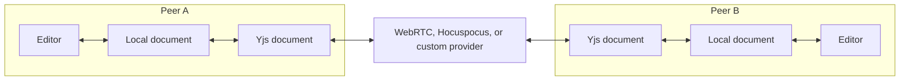

This reference documents the complete configuration and API behavior for real-time DOCX collaboration with the Pro package. It covers providers, room lifecycles, presence, recovery, and resource limits.

For a basic WebRTC setup, use the [real-time collaboration quickstart](/docs/2.x/collaboration).

The Pro module replicates text, structure, formatting, tables, headers, footers, notes, drawings, relationships, and embedded parts. Peers also share presence and remote selections across paragraphs. Your caret and each remote caret stay beside the same character while others type, delete, split, or join the paragraph around it.

Collaboration requires the collaboration module from [`@docx-editor.dev/pro`](/docs/2.x/pro).

Without that module, the editor does not attach a replica. Local undo remains active. `snapshot().collaborationStatus` is `'inactive'`.



## Find your integration path

| Task | Guide |
| --- | --- |
| Connect two editors | [Collaboration quickstart](/docs/2.x/collaboration) |
| Use a room server | [Hocuspocus setup](#connect-to-a-hocuspocus-server), [server document preparation](#prepare-the-room-document-on-a-server), and [server seeding](#seed-new-rooms-on-a-server) |
| Show connection state and participants | [Status and participants](#show-status-and-participants) |
| Recover local work | [Replica recovery](#recover-a-diverged-replica) and [offline editing](#edit-offline) |
| Connect a server agent | [Server agent redlines](#let-a-server-agent-propose-redlines) |
| Upgrade a deployment | [Client checks and saved-room migration](/docs/2.x/pro/collaboration-versions) |

Check client compatibility before synchronization. Validate saved rooms before loading them into a live document. Prepare each server document before applying updates. Keep the editor mounted after connection failures so users can save local work.

## Prerequisites

Install the Pro package, Yjs, and the provider for your transport.

For WebRTC, run:

```bash
npm install @docx-editor.dev/pro yjs y-webrtc
```

For Hocuspocus, run:

```bash
npm install @docx-editor.dev/pro yjs @hocuspocus/provider
```

`yjs`, `y-webrtc`, and `@hocuspocus/provider` are optional Pro peer dependencies. Pro installs `y-protocols`.

## Plan deployment and upgrades

Use the dedicated [collaboration format version](/docs/2.x/pro/collaboration-versions) to check clients before synchronization. Check saved rooms separately before loading them. The guide covers server admission, offline work, and migration.

## Connect with `useWebrtcCollaboration`

`useWebrtcCollaboration` owns the WebRTC room. It creates the replica and builds `modules`. It destroys the room when you leave.

The WebRTC subpath keeps the network provider out of review-only bundles. Import `@docx-editor.dev/pro/react/webrtc` or `@docx-editor.dev/pro/vue/webrtc`.

Pass `room` to connect when the component mounts. Call `leave` to end the session. Mount the editor when `document` is available. Keep it mounted after a session failure so users can save local work.

The hook returns an object. Its `session` field contains a `CollaborationSession`. The session exposes identity, status, presence, and undo. It does not expose `attach` or `gateOperations`. `CollaborationSession`, `CollaborationStatus`, and `CollaborationFailure` are exported types from `@docx-editor.dev/pro/react` and `@docx-editor.dev/pro/vue`.

Room failures make `connect` and `rejoin` resolve to a `CollaborationFailure`. Success resolves to `null`. `rejoin` still throws if you call it before a connection attempt. The hook also puts room failures in `error` for rendering:

```tsx
const failure = await connect(options);
if (failure?.code === 'initialization-timeout') {
  // No room server answered.
}
```

Branch on `failure.code` or `error.code` instead of matching message strings. `error` reports an initial connection failure or a session failure after connection. An expired token, `concurrent-seed`, or digest mismatch can occur after a successful join. Always handle `error`, even when `document` is not `null`.

The `<DocxEditor>` host accepts `document` and `modules`. You do not need `DocxEditor.Root` for collaboration.

Pass review and custom-node modules through the hook’s `modules` option. Pass its returned `modules` to the editor. The hook adds `collaborationModule`; adding another collaboration module throws a configuration error.

<FrameworkTabs>
<Framework value="react">

```tsx
import { useRef } from 'react';
import { DocxEditor, type DocxEditorRef } from '@docx-editor.dev/react';
import { DEMO_SIGNALING_ENDPOINTS } from '@docx-editor.dev/pro/collaboration/webrtc';
import { useWebrtcCollaboration } from '@docx-editor.dev/pro/react/webrtc';

type CollaborativeEditorProps = {
  roomId: string;
  bytes: Uint8Array;
  actorId: string;
  name: string;
};

export function CollaborativeEditor({ roomId, bytes, actorId, name }: CollaborativeEditorProps) {
  const editorRef = useRef<DocxEditorRef>(null);
  const { document, modules, session, error, leave } = useWebrtcCollaboration({
    room: {
      roomId,
      identity: { actorId, name },
      bootstrap: { kind: 'create-or-join', document: bytes },
      // Demo only. Pass your own signaling URLs in production.
      signaling: DEMO_SIGNALING_ENDPOINTS,
    },
  });

  async function leaveRoom() {
    // `leave` requires current bytes. The hook cannot read them.
    const saved = await editorRef.current?.save();
    if (saved) {
      leave(new Uint8Array(saved));
    }
  }

  if (!document) {
    return <p>{error ? 'Could not join this document.' : 'Connecting…'}</p>;
  }

  return (
    <>
      {error && (
        <p role="alert">Collaboration needs attention. Save a copy before you reconnect.</p>
      )}
      <button type="button" onClick={leaveRoom}>
        Leave
      </button>
      <DocxEditor ref={editorRef} key={session?.sessionId} document={document} modules={modules} />
    </>
  );
}
```

</Framework>
<Framework value="vue">

```vue
<script setup lang="ts">
import { ref } from 'vue';
import { DocxEditor, type DocxEditorRef } from '@docx-editor.dev/vue';
import { DEMO_SIGNALING_ENDPOINTS } from '@docx-editor.dev/pro/collaboration/webrtc';
import { useWebrtcCollaboration } from '@docx-editor.dev/pro/vue/webrtc';

const props = defineProps<{
  roomId: string;
  bytes: Uint8Array;
  actorId: string;
  name: string;
}>();

const editorRef = ref<DocxEditorRef | null>(null);
const { document, modules, session, error, leave } = useWebrtcCollaboration(() => ({
  room: {
    roomId: props.roomId,
    identity: { actorId: props.actorId, name: props.name },
    bootstrap: { kind: 'create-or-join', document: props.bytes },
    // Demo only. Pass your own signaling URLs in production.
    signaling: DEMO_SIGNALING_ENDPOINTS,
  },
}));

async function leaveRoom() {
  // `leave` requires current bytes.
  const saved = await editorRef.value?.save();
  if (saved) {
    leave(new Uint8Array(saved));
  }
}
</script>

<template>
  <p v-if="error" role="alert">
    Collaboration is unavailable. Save any local work before you reconnect.
  </p>
  <p v-if="!document && !error">Connecting…</p>
  <template v-if="document">
    <button type="button" @click="leaveRoom">Leave</button>
    <DocxEditor ref="editorRef" :key="session?.sessionId" :document="document" :modules="modules" />
  </template>
</template>
```

</Framework>
</FrameworkTabs>

With `create-or-join`, every peer uses the same room and bootstrap settings. Each peer must use a unique `actorId`. The first peer seeds the empty room from `document`. Later peers join the existing room. Use `create` or `join` when each host already knows its role. A Hocuspocus server can seed new rooms itself; for more information, see [Seed new rooms on a server](#seed-new-rooms-on-a-server).

With Hocuspocus, `create` waits for the server's state before it seeds. If the room already holds a document, `create` fails with `already-initialized` and seeds nothing. If the server does not answer within `syncedTimeoutMs`, `create` fails with `initialization-timeout`.

Two isolated peers can seed the same room at the same time. This creates a room that clients cannot repair. Each replica reports `concurrent-seed` and stops. Create a new room from saved bytes.

Omit `room` when the user chooses to share or join later. Then call `connect` with the same options. `connect` and `leave` keep stable identities across renders.

If you change the room, server, bootstrap kind, or `actorId` in `room`, the hook leaves the old room and connects to the new one. If you set `room` to `null`, the hook leaves. A room you open with `connect` stays connected until you call `leave`.

Before changing rooms, save local work and check `unsyncedChanges`. Automatic room changes do not preserve the previous editor’s bytes.

The editor reads `modules` at construction time. Set `key` to the session `sessionId`, as shown in the examples. Without `key`, a connection after mount does not register the collaboration module. The editor continues local editing, and no changes replicate. The session logs a warning if you create it without attaching it.

The hook also returns `ydoc` and `provider`. Both values are `null` before the first room connects. Use them for persistence or direct provider access. `rejoin(bytes)` leaves with saved bytes and rejoins the same room after an `error` status.

The default Pro entry exports `collaborationModule` without a network provider. Import `@docx-editor.dev/pro/collaboration` for Yjs factories. Import `@docx-editor.dev/pro/collaboration/webrtc` for room helpers such as `createCollaborationRoomId`.

## Mount the editor

A collaborative root needs three values from the room. `key` remounts the editor for a new session. `document` contains the room bytes. `modules` contains the hook modules. Incorrect values can create a working editor that does not replicate edits.

`DocxEditorCollaborationRoot` sets all three values. Import it with `DocxEditorCollaboration` from the framework entry. It also uses the room identity name as `author`. Set `author` to override this value. Other `DocxEditor.Root` props pass through.

<FrameworkTabs>
<Framework value="react">

```tsx
import { DocxEditor } from '@docx-editor.dev/react';
import { DocxEditorCollaboration, DocxEditorCollaborationRoot } from '@docx-editor.dev/pro/react';
import {
  useHocuspocusCollaboration,
  type UseHocuspocusCollaborationConnectOptions,
} from '@docx-editor.dev/pro/react/hocuspocus';

interface CollaborativeEditorProps {
  room: UseHocuspocusCollaborationConnectOptions;
}

export function CollaborativeEditor({ room }: CollaborativeEditorProps) {
  const collaboration = useHocuspocusCollaboration({ room });

  return (
    <div className="docx-editor">
      {collaboration.error && (
        <p role="alert">Collaboration is unavailable. Save any local work.</p>
      )}
      <DocxEditorCollaborationRoot
        collaboration={collaboration}
        fallback={<p>{collaboration.error ? 'Could not connect.' : 'Connecting…'}</p>}
      >
        <DocxEditor.Menu />
        <DocxEditor.Toolbar />
        <DocxEditor.Viewport>
          <DocxEditor.Content />
          <DocxEditorCollaboration.CaretLabels />
        </DocxEditor.Viewport>
      </DocxEditorCollaborationRoot>
    </div>
  );
}
```

React renders `fallback` when `document` is `null`. Use `error` to distinguish a failed connection from a pending connection. Keep an existing editor mounted during failures so users can save local work.

</Framework>
<Framework value="vue">

```vue
<script setup lang="ts">
import { reactive } from 'vue';
import { DocxEditor } from '@docx-editor.dev/vue';
import { DocxEditorCollaboration, DocxEditorCollaborationRoot } from '@docx-editor.dev/pro/vue';
import {
  useHocuspocusCollaboration,
  type UseHocuspocusCollaborationConnectOptions,
} from '@docx-editor.dev/pro/vue/hocuspocus';

const props = defineProps<{ room: UseHocuspocusCollaborationConnectOptions }>();
const collaboration = reactive(useHocuspocusCollaboration(() => ({ room: props.room })));
</script>

<template>
  <div class="docx-editor">
    <p v-if="collaboration.error" role="alert">
      Collaboration is unavailable. Save any local work before you reconnect.
    </p>
    <DocxEditorCollaborationRoot :collaboration="collaboration">
      <DocxEditor.Menu />
      <DocxEditor.Toolbar />
      <DocxEditor.Viewport>
        <DocxEditor.Content />
        <DocxEditorCollaboration.CaretLabels />
      </DocxEditor.Viewport>
      <template #fallback>
        <p>{{ collaboration.error ? 'Could not connect.' : 'Connecting…' }}</p>
      </template>
    </DocxEditorCollaborationRoot>
  </div>
</template>
```

Pass the options as a getter so the composable follows a change to the `room` prop. Vue composables return refs. Wrap the return with `reactive` before you pass it to `DocxEditorCollaborationRoot`. Vue renders the named `fallback` slot whenever `document` is `null`. Without that slot, it renders nothing. Show errors beside an existing editor so users can save local work.

</Framework>
</FrameworkTabs>

Use `DocxEditor.Root` directly when one page mounts two rooms, or when the bytes come from somewhere the component cannot see:

```tsx
if (!collaboration.document) {
  return <p>{collaboration.error ? 'Could not connect.' : 'Connecting…'}</p>;
}

return (
  <div className="docx-editor">
    {collaboration.error && (
      <p role="alert">Collaboration needs attention. Save a copy before you reconnect.</p>
    )}
    <DocxEditor.Root
      key={collaboration.session?.sessionId ?? 'local'}
      document={collaboration.document}
      modules={collaboration.modules}
      author={collaboration.session?.identity.name}
    >
      <DocxEditor.Menu />
      <DocxEditor.Viewport>
        <DocxEditor.Content />
      </DocxEditor.Viewport>
    </DocxEditor.Root>
  </div>
);
```

## Show status and participants

`useCollaborationStatus()` returns these fields:

- `status` gives the session state, or `inactive` when no session exists.
- `reason` gives the cause of the present state, such as a failing WebRTC peer link while the status is `ready`. It clears after recovery.
- `lastFailure` keeps the latest `error` failure after the status changes. A reason that comes with `ready` or `disconnected` does not set it.
- `live` is true when edits made now reach the room.
- `diverged` is true when `status` is `destroyed`, or `error` that does not heal on its own. Call `rejoin` to recover a room that the hook connected before.
- `recovering` is true when `status` is `error` but the session heals on the next update. Show a short notice, not a rejoin action.
- `waiting` is true while edits wait for the room: the editor cannot show a change until an update that it depends on arrives. The editor refuses edits meanwhile and accepts them again when the update arrives.
- `failureCount` counts the failures the session recorded. It changes with each new failure, also when `lastFailure` repeats the same code, so you can tell users each time the room refuses an edit.
- `attached` is true when an editor has attached its document port. A live, unattached session usually means the editor did not remount for the session.

`useCollaborationParticipants()` returns the room participants.

Both hooks accept an optional `session`. Omit it to read the session from the editor provider. Pass it for a room that the editor does not own. The presence parts use the same rule. `session` is optional on `DocxEditorCollaboration.Avatars` and `DocxEditorCollaboration.CaretLabels`.

All of these are available from `@docx-editor.dev/pro/react` and `@docx-editor.dev/pro/vue`.

If you own the Yjs resources, use `useDocumentCollaboration` from the same entries. It provides the same `connect` and `leave` lifecycle without WebRTC.

## Show the room status

`DocxEditorCollaboration.Status` tells users what they need to know about the room. It shows nothing while everything is in order. It reports these states:

- Connecting to the room.
- Offline. The message says whether users can keep editing, which depends on `offlineEditing`.
- Catching up after an update that the session could not apply yet.
- Edits wait for the latest changes from the room. If the wait lasts longer than 10 seconds, the part offers **Rejoin**.
- The room refused an edit, and the editor undid it.
- Out of sync. If you handle the rejoin, the part shows a **Rejoin** button.
- An upgrade is required, because this client and the room use different collaboration formats. Either side can be the older one; for the steps, see [collaboration upgrades](/docs/2.x/pro/collaboration-versions). Rejoining cannot fix this, so the part shows no button.
- A new room is required, because the room itself cannot continue: two seeds merged, a stored file is damaged, or the room reached a resource limit. Rejoining the same room cannot fix this, so the part shows no button. Save a copy and share it in a new room.

The messages come from the editor's translations. The part keeps an empty region with `role="status"` mounted, so screen readers announce each message when it appears.

To show the **Rejoin** button, preserve a recovery copy, then pass saved bytes to your provider hook’s `rejoin` function:

<FrameworkTabs>
<Framework value="react">

```tsx
// Implement a confirmed download or durable application storage.
// Reject if the recovery copy cannot be preserved.
declare function preserveRecoveryCopy(bytes: Uint8Array): Promise<void>;

const { rejoin } = useHocuspocusCollaboration({ room });

async function rejoinRoom() {
  const saved = await editorRef.current?.save();
  if (saved) {
    const bytes = new Uint8Array(saved);
    await preserveRecoveryCopy(bytes);
    await rejoin(bytes);
  }
}

<DocxEditorCollaboration.Status onRejoin={rejoinRoom} />;
```

</Framework>
<Framework value="vue">

```vue
<DocxEditorCollaboration.Status @rejoin="rejoinRoom" />
```

</Framework>
</FrameworkTabs>

To render your own notice, pass a render function in React or a default slot in Vue. It receives `kind`, the translated `message`, and optional `rejoin` for out-of-sync or stalled sessions. For CSS styling, use the `docx-collaboration-status` class and the `data-collaboration-status` attribute.

## Show avatars and caret labels

`DocxEditorCollaboration` provides presence controls. Import it from `@docx-editor.dev/pro/react` or `@docx-editor.dev/pro/vue`. Mount its parts anywhere in the editor provider tree.

`DocxEditorCollaboration.Avatars` renders participant initials. It puts the local participant first.

```tsx
<DocxEditorCollaboration.Avatars max={4} />
```

Avatar colors match each collaborator's tracked changes and comments. `max` collapses extra avatars into a `+N` chip. Use `DocxEditorCollaboration.Avatar` to render one participant.

You can replace each avatar disc with a renderer. It receives `participant`, `color`, `initials`, and the locally resolved optional `avatarUrl`.

```tsx
<DocxEditorCollaboration.Avatars max={4}>
  {({ participant, avatarUrl, initials }) =>
    avatarUrl ? (
      
    ) : (
      <span aria-label={participant.name}>{initials}</span>
    )
  }
</DocxEditorCollaboration.Avatars>
```

`participant` contains `actorId`, `name`, optional `color`, optional `role`, and `isLocal`.

Avatars show the picture declared for a collaborator, so one declaration covers every surface that draws that person:

```tsx
<DocxEditor.AuthorStyle author="Alex Kim" color="#1f7a4d" avatarUrl="/team/alex.jpg" />
```

The review card, the caret label, and the avatar stack all resolve it by display name, which is the string `w:author` carries in the saved file. A declared color outranks the one a peer publishes in `identity.color`: the declaration is your own record of who someone is, and a peer must not be able to make their caret disagree with their comment cards. `identity.color` still applies to anyone you have not declared.

`DocxEditorCollaboration.CaretLabels` replaces each remote caret label. The engine positions and colors the label. Your renderer mounts in the adapter tree, so editor and review hooks work inside it.

<FrameworkTabs>
<Framework value="react">

```tsx
<DocxEditorCollaboration.CaretLabels>
  {({ selection, participant, color, avatarUrl }) => (
    <MyLabel name={participant?.name ?? selection.name} color={color} avatarUrl={avatarUrl} />
  )}
</DocxEditorCollaboration.CaretLabels>
```

</Framework>
<Framework value="vue">

```vue
<DocxEditorCollaboration.CaretLabels v-slot="{ selection, participant, color, avatarUrl }">
  <MyLabel
    :name="participant?.name ?? selection.name"
    :color="color"
    :avatar-url="avatarUrl"
  />
</DocxEditorCollaboration.CaretLabels>
```

</Framework>
</FrameworkTabs>

The renderer receives `selection`, optional `participant`, `color`, and optional `avatarUrl`. In Vue, it is the default scoped slot. Without a renderer, the label shows the collaborator's name.

The engine marks the label layer `aria-hidden` and disables pointer events. Screen readers do not announce label content. Label content cannot receive clicks or focus. Put interactive or announced presence controls in your own chrome.

For CSS styling, use the `docx-remote-caret-label` class, `--doc-remote-color` custom property, and `data-docx-remote-actor` attribute.

## Recover a diverged replica

A status of `error` pauses editing. The replica keeps its last good copy of the document.

Some errors heal on their own. If the replica could not show a peer's update yet, for example `remote-apply-failed` or `materialize-dropped-content`, it returns to its earlier status when a later update completes the shared state. Other errors are terminal: version mismatches, `concurrent-seed`, `blob-digest-mismatch`, resource limits, and `authentication-failed`. For those, waiting does not fix the replica.

On WebRTC, a peer link that keeps losing large updates keeps the status `ready` and sets the reason `transport-disconnected` with the detail `a peer link cannot carry large updates`. Editing continues for every participant, and the other peers still receive each edit. The reason clears when that link recovers.

For `collaboration-format-mismatch`, `protocol-version-mismatch`, or `schema-version-mismatch`, preserve local work and follow [collaboration upgrades](/docs/2.x/pro/collaboration-versions). Rejoining the same incompatible room cannot resolve these errors.

For other failures, resolve the cause before calling `rejoin`:

```tsx
// Implement a confirmed download or durable application storage.
// Reject if the recovery copy cannot be preserved.
declare function preserveRecoveryCopy(bytes: Uint8Array): Promise<void>;

const { rejoin } = useHocuspocusCollaboration({ room });

async function rejoinRoom() {
  const saved = await editorRef.current?.save();
  if (saved) {
    const bytes = new Uint8Array(saved);
    await preserveRecoveryCopy(bytes);
    await rejoin(bytes);
  }
}
```

Preserve a recovery copy outside the editor before you call `rejoin`. `preserveRecoveryCopy` represents your application’s confirmed download or durable storage. If it fails, keep the existing editor mounted and stop recovery. `rejoin` leaves with the saved bytes, then joins the same room with `{ kind: 'join' }`. A successful join uses the room copy. It can drop unreplicated changes that existed when the session failed. After a failed join, the saved bytes stay mounted locally.

## Edit offline

The session accepts edits while its status is `disconnected`. It merges buffered updates after reconnection. Show the status so users know when edits have not reached the room.

Buffered edits live in the browser's memory until they reach the room. A reload, an unmount, or a change of the `room` option drops them. To keep them across reloads, persist the Yjs document. For example, attach `y-indexeddb` to the `ydoc` you pass to `useDocumentCollaboration`.

`useHocuspocusCollaboration` and `useWebrtcCollaboration` return `unsyncedChanges`. Its meaning depends on the transport:

- With Hocuspocus, it counts the changes that the server has not confirmed.
- With WebRTC, it counts the changes made while no peer was connected. A WebRTC room has no server, so these changes exist only in your browser until a peer connects and syncs. To warn users before they close a page with unsent edits, add a `beforeunload` listener while the count is above zero:

```tsx
const { unsyncedChanges } = useHocuspocusCollaboration({ room });

useEffect(() => {
  if (unsyncedChanges === 0) return;
  const warn = (event: BeforeUnloadEvent) => event.preventDefault();
  window.addEventListener('beforeunload', warn);
  return () => window.removeEventListener('beforeunload', warn);
}, [unsyncedChanges]);
```

A zero count does not confirm durable server storage. Persist room updates on the server and handle storage failures separately.

To pause editing while disconnected, set `offlineEditing: false` in the `room` or `connect` options. Every room factory and hook accepts this option. The session refuses edits in the `error` status in both cases.

## Upgrade WebRTC configuration to 2.31.0

Version 2.31.0 includes a security compatibility exception: WebRTC no longer selects public signaling servers when you omit `signaling`. Existing callers must provide this option before connecting.

Update `createWebrtcCollaboration`, `useWebrtcCollaboration`, and `connect` options in React and Vue:

- For production, set `signaling` to your own signaling server URLs.
- For demos, explicitly pass `DEMO_SIGNALING_ENDPOINTS`.
- For communication between tabs of one browser, pass `[]`. This does not connect peers in different browsers.

Hocuspocus connections do not use this option.

## Use your own signaling

A WebRTC room needs signaling URLs that introduce peers to each other. The `signaling` option has no default, and the TypeScript types require it. Each entry must be a `ws://` or `wss://` URL. If you omit the option or pass an invalid entry, no network connection opens, and the failure appears as follows:

- `createWebrtcCollaboration` rejects with a `TypeError`.
- `connect` resolves with a `transport` failure and sets `error`.
- A `room` option connection sets `error` to a `transport` failure.

To recover, add `signaling` and call `connect` again. `rejoin` reuses the options of the last connection attempt, so it fails again until you call `connect` with corrected options. Read the failure `code`. Do not parse its `detail` text.

`DEMO_SIGNALING_ENDPOINTS` is a shared, unauthenticated public signaling service. It receives every room ID. Without a `password`, it also receives the signaling messages in plaintext. Use it only for demos, and pass it explicitly.

For production, pass your signaling URLs in the `room` option of `useWebrtcCollaboration`, to `connect`, or to `createWebrtcCollaboration`. Also provide your own Traversal Using Relays around NAT (TURN) servers. Many networks block direct WebRTC connections without TURN.

The following room options use your own servers. The Vue composable exports the same type from `@docx-editor.dev/pro/vue/webrtc`.

```ts
import type { UseWebrtcCollaborationConnectOptions } from '@docx-editor.dev/pro/react/webrtc';

const room: UseWebrtcCollaborationConnectOptions = {
  roomId,
  identity: { actorId, name },
  bootstrap: { kind: 'create-or-join', document: bytes },
  signaling: ['wss://signaling.example.com'],
  iceServers: [
    {
      urls: 'turn:turn.example.com:3478',
      username: turnUser,
      credential: turnCredential,
    },
  ],
};
```

Each room uses only the signaling URLs that it lists. If a page opens rooms with different `signaling` lists, no room sends its room ID or announcements to another room's server. An empty `signaling` list opens no signaling connection. Only editors in tabs of the same browser can then find each other.

After the first WebRTC room opens, the same rule applies to every `y-webrtc` provider in the page, including providers that your application creates directly. Destroying a provider also closes its signaling connections. This applies only to providers that you create after the first room opens. If you create a provider earlier, call its `disconnect()` before `destroy()`.

## Connect to a Hocuspocus server

`useHocuspocusCollaboration` owns a room on a [Hocuspocus](https://tiptap.dev/docs/hocuspocus) server. It has the same options, return values, and lifecycle as `useWebrtcCollaboration`. A server-backed room does not need signaling or TURN configuration.

Import the hook from `@docx-editor.dev/pro/react/hocuspocus`. Import the Vue composable from `@docx-editor.dev/pro/vue/hocuspocus`.

```tsx
import { DocxEditor } from '@docx-editor.dev/react';
import { useHocuspocusCollaboration } from '@docx-editor.dev/pro/react/hocuspocus';

export function ServerBackedEditor({
  roomId,
  token,
  bytes,
  actorId,
  name,
}: {
  roomId: string;
  token: string;
  bytes: Uint8Array;
  actorId: string;
  name: string;
}) {
  const { document, modules, session, error } = useHocuspocusCollaboration({
    room: {
      url: 'wss://collab.example.test',
      roomId,
      token,
      identity: { actorId, name },
      bootstrap: { kind: 'create-or-join', document: bytes },
    },
  });

  if (!document) {
    return <p>{error ? 'Could not join this document.' : 'Connecting…'}</p>;
  }

  return (
    <>
      {error && (
        <p role="alert">Collaboration needs attention. Save a copy before you reconnect.</p>
      )}
      <DocxEditor key={session?.sessionId} document={document} modules={modules} />
    </>
  );
}
```

If your server seeds new rooms, pass `bootstrap: { kind: 'join' }` instead. For more information, see [Seed new rooms on a server](#seed-new-rooms-on-a-server).

`token` reaches the server’s `onAuthenticate` hook. If tokens expire, pass a callback that reads the latest credential. The provider calls it for each reconnection.

Changing a token string in `room` does not reconnect the hook. `rejoin` reuses the options from the last connection attempt. Use a token callback for renewal, or preserve local work and call `connect` with updated credentials.

The provider preserves recognized collaboration failure codes from the server both during the initial join and after reconnecting. For `collaboration-format-mismatch`, follow the [upgrade guide](/docs/2.x/pro/collaboration-versions); refreshing credentials cannot resolve a version mismatch.

An unrecognized authentication refusal produces `initialization-aborted` during initialization or `authentication-failed` after joining. Both keep the server's reason in `detail` for logs. For a rejected credential, refresh it before calling `rejoin`. A `transport-disconnected` failure recovers on its own.

`syncedTimeoutMs` limits the initial sync wait. Its default is 30 seconds. A timeout produces `initialization-timeout`. The bootstrap `signal` covers the whole join, the server's load of the room included. An aborted join fails with `initialization-aborted`, also when the room is already present.

The `createHocuspocusCollaboration` factory accepts the same options. Import it from `@docx-editor.dev/pro/collaboration/hocuspocus`. It returns the room, `ydoc`, and `provider`.

The Hocuspocus v4 server runs on Node, not Bun. Use `@hocuspocus/provider` for the required authentication handshake.

## Prepare the room document on a server

If your server holds each room's `Y.Doc`, as a Hocuspocus server does, pass that document to `prepareCollaborationServerDocument` when the server creates or loads it. Call it before the server applies any update, including the room's saved state.

Yjs removes formatting markers that it finds redundant after it receives an update. On a server, that removal is a change of the server's own, which the server sends to every participant. It can remove the formatting of text that a participant is typing. A prepared document does not remove markers.

The client chooses `documentName`, so treat it as untrusted. The examples in this guide accept only the room ID shape before they use the name in a file path. They omit authentication. A production server also checks in `onAuthenticate` that the user may open the room.

```ts
import { readFile } from 'node:fs/promises';
import path from 'node:path';
import { Server } from '@hocuspocus/server';
import * as Y from 'yjs';
import {
  assertCollaborationFormatCompatibility,
  checkCollaborationRoomGeneration,
  prepareCollaborationServerDocument,
  readCollaborationDocument,
  readCollaborationFormatVersion,
} from '@docx-editor.dev/pro/collaboration';

const ROOMS_DIR = '/var/lib/rooms';
// No `.`, `/`, or `\`, so a room name cannot leave ROOMS_DIR.
const ROOM_ID = /^[A-Za-z0-9_-]{24,256}$/;

function roomFile(documentName: string): string {
  if (!ROOM_ID.test(documentName)) throw new Error('unknown room');
  return path.join(ROOMS_DIR, `${documentName}.ydoc`);
}

async function readSavedRoom(file: string): Promise<Uint8Array | null> {
  try {
    return new Uint8Array(await readFile(file));
  } catch (error) {
    if (error !== null && typeof error === 'object' && 'code' in error && error.code === 'ENOENT') {
      return null;
    }
    throw error;
  }
}

const server = new Server({
  async onLoadDocument({ documentName, document }) {
    prepareCollaborationServerDocument(document);
    // Load the saved state after the preparation.
    const saved = await readSavedRoom(roomFile(documentName));
    if (saved) {
      const candidate = new Y.Doc();
      try {
        prepareCollaborationServerDocument(candidate);
        Y.applyUpdate(candidate, saved);
        assertCollaborationFormatCompatibility(readCollaborationFormatVersion(candidate));
        readCollaborationDocument(candidate);
        Y.applyUpdate(document, saved);
      } finally {
        candidate.destroy();
      }
    }
    return document;
  },
  async afterLoadDocument({ document }) {
    // Send the loaded state to nobody before the first participant joins.
    document.flush();
  },
  async beforeHandleMessage(payload) {
    checkCollaborationRoomGeneration(payload);
  },
});
```

Hocuspocus 4.6 holds back an update smaller than `flushMaxBytes` until its next turn, and then sends it to every connection. Without `document.flush()`, the state that `onLoadDocument` applies reaches the first participant twice: once in its own sync, and once more as an update. Call `document.flush()` in `afterLoadDocument`. That hook runs after every `onLoadDocument` hook, those of extensions included, and before the first participant joins.

Preparation preserves formatting markers; it does not validate a room or authenticate a client. The example validates saved data in a temporary document before loading it. Storage and validation failures stop loading. Keep the saved state for recovery. Add [client admission checks](/docs/2.x/pro/collaboration-versions#check-clients-before-synchronization) before production use.

Hocuspocus runs the hooks of its extensions before the server's own hooks. If an extension loads the saved state, such as `@hocuspocus/extension-database`, prepare the document in an extension that runs first. The following extension has a higher priority than the default of 100:

```ts
import type { Extension } from '@hocuspocus/server';
import { prepareCollaborationServerDocument } from '@docx-editor.dev/pro/collaboration';

export const prepareRoomDocument: Extension = {
  priority: 1000,
  async onLoadDocument({ document }) {
    prepareCollaborationServerDocument(document);
  },
};
```

List it with your other extensions, for example `extensions: [prepareRoomDocument, database]`.

A server that only relays updates, and holds no `Y.Doc`, needs no preparation.

## Seed new rooms on a server

With a `create` or `create-or-join` bootstrap, the first participant seeds an empty room from its own `document` bytes. On Hocuspocus, that participant uploads the whole room state, and the server sends the same state back to it, because Hocuspocus sends every update to every connection, the sender included. The room state of a document is often larger than its `.docx` file.

If your server knows which document a room edits, seed the room on the server instead. `createCollaborationState` takes the `.docx` bytes and the room name, and returns the room's Yjs state. Participants find the room seeded and join it with `join` or `create-or-join`. No participant uploads the document, and each participant receives it once.

Seed a room only when your application knows that the room is new. A second seed of a room that already exists replaces its content with the original file, and every edit made since is gone from the room. If the server knows a room but cannot find its stored state, refuse the room with `saved-room-unavailable`. Participants keep their copies while you restore the state.

The following server keeps three kinds of files. The application writes a room's `.docx` file when it creates the room. The server writes the room's state, and a record that it seeded the room. Keep the records apart from the state, for example in your database, so that losing the state does not also lose the record. Every write of new state is create-only, so two server processes that load one new room at the same time keep one seed. When the server loads stored state that has no record, it writes the record, so a crash between the two writes does not leave a room unprotected.

```ts
import { link, open, readFile, rename, unlink } from 'node:fs/promises';
import { randomUUID } from 'node:crypto';
import path from 'node:path';
import { Server } from '@hocuspocus/server';
import * as Y from 'yjs';
import {
  CollaborationSchemaError,
  checkCollaborationRoomGeneration,
  createCollaborationState,
  prepareCollaborationServerDocument,
} from '@docx-editor.dev/pro/collaboration';

// The .docx file each room starts from, written when the application creates the room.
const DOCUMENTS_DIR = '/var/lib/documents';
// Each room's Yjs state.
const ROOMS_DIR = '/var/lib/rooms';
// One record for each room the server seeded. Keep it apart from the state.
const SEEDED_DIR = '/var/lib/rooms-seeded';
// The largest document, expanded, that the server seeds a room from.
const MAX_SEED_BYTES = 4 * 1024 * 1024;
// No `.`, `/`, or `\`, so a room name cannot leave these directories.
const ROOM_ID = /^[A-Za-z0-9_-]{24,256}$/;

/** An error whose reason Hocuspocus sends to the client that it refuses. */
function refusal(reason: string): Error & { reason: string } {
  return Object.assign(new Error(reason), { reason });
}

function fileOf(directory: string, documentName: string, extension: string): string {
  if (!ROOM_ID.test(documentName)) throw refusal('unknown-room');
  return path.join(directory, `${documentName}${extension}`);
}

/** The file's bytes, or null when it does not exist. Other storage errors stop the load. */
async function readIfPresent(file: string): Promise<Uint8Array | null> {
  try {
    return new Uint8Array(await readFile(file));
  } catch (error) {
    if ((error as NodeJS.ErrnoException).code === 'ENOENT') return null;
    throw refusal('saved-room-unavailable');
  }
}

/** Write a file that must not exist yet. Resolves false when it exists. */
async function writeNew(file: string, bytes: Uint8Array): Promise<boolean> {
  const temporary = `${file}.${randomUUID()}.tmp`;
  try {
    const handle = await open(temporary, 'wx');
    try {
      await handle.writeFile(bytes);
      await handle.sync();
    } finally {
      await handle.close();
    }
    await link(temporary, file); // Fails with EEXIST when the file exists.
    return true;
  } catch (error) {
    if ((error as NodeJS.ErrnoException).code === 'EEXIST') return false;
    throw error;
  } finally {
    await unlink(temporary).catch(() => undefined);
  }
}

/** Replace a file. A unique temporary name keeps two overlapping writes apart. */
async function writeReplacing(file: string, bytes: Uint8Array): Promise<void> {
  const temporary = `${file}.${randomUUID()}.tmp`;
  try {
    const handle = await open(temporary, 'wx');
    try {
      await handle.writeFile(bytes);
      await handle.sync();
    } finally {
      await handle.close();
    }
    await rename(temporary, file);
  } finally {
    await unlink(temporary).catch(() => undefined);
  }
}

/** Write the room's seed record if it has none. */
async function recordSeeded(documentName: string): Promise<void> {
  const record = fileOf(SEEDED_DIR, documentName, '.seeded');
  if (!(await readIfPresent(record))) await writeNew(record, new Uint8Array());
}

async function seedRoom(documentName: string, stateFile: string): Promise<Uint8Array> {
  const docx = await readIfPresent(fileOf(DOCUMENTS_DIR, documentName, '.docx'));
  if (!docx) throw refusal('unknown-room');
  let state: Uint8Array;
  try {
    // Runs on this thread for brevity. See "Plan for the cost of a seed".
    state = await createCollaborationState(docx, {
      documentId: documentName,
      maxBytes: MAX_SEED_BYTES,
    });
  } catch (error) {
    // For example `baseline-too-large`: the client reports it at once.
    throw refusal(error instanceof CollaborationSchemaError ? error.code : 'invalid-baseline');
  }
  // Hocuspocus does not store state applied while it loads a room, so store it now.
  if (!(await writeNew(stateFile, state))) {
    // Another server process seeded the room first. Use its state.
    const existing = await readIfPresent(stateFile);
    if (!existing) throw refusal('saved-room-unavailable');
    state = existing;
  }
  await recordSeeded(documentName);
  return state;
}

const server = new Server({
  async onLoadDocument({ documentName, document }) {
    prepareCollaborationServerDocument(document);
    const stateFile = fileOf(ROOMS_DIR, documentName, '.ydoc');
    let state = await readIfPresent(stateFile);
    if (!state) {
      // A room the server seeded before has lost its state. Never seed it again.
      if (await readIfPresent(fileOf(SEEDED_DIR, documentName, '.seeded'))) {
        throw refusal('saved-room-unavailable');
      }
      state = await seedRoom(documentName, stateFile);
    } else {
      // A crash between the state write and the record write leaves a room without a record.
      await recordSeeded(documentName);
    }
    Y.applyUpdate(document, state);
    return document;
  },
  async afterLoadDocument({ document }) {
    // Send the loaded state to nobody before the first participant joins.
    document.flush();
  },
  async beforeHandleMessage(payload) {
    checkCollaborationRoomGeneration(payload);
  },
  async onStoreDocument({ documentName, document }) {
    const stateFile = fileOf(ROOMS_DIR, documentName, '.ydoc');
    await writeReplacing(stateFile, Y.encodeStateAsUpdate(document));
  },
});

await server.listen();
```

The example omits authentication and the validation of saved rooms. In production, check in `onAuthenticate` that the user may open the room, and refuse a room that has no document there, before the room loads. Validate saved rooms as [Prepare the room document on a server](#prepare-the-room-document-on-a-server) shows.

Each seed also carries a new room generation ID. If the server loses both a room's state and its record and seeds the room again, `checkCollaborationRoomGeneration` refuses a participant that still holds the earlier room with `room-generation-changed`. That participant keeps its document and can save a copy. The edits it holds are not in the new room.

### Seed with the database extension

With `@hocuspocus/extension-database`, seed the room in `fetch`. When the room has no row and no seed record, create the state, insert it with a create-only statement such as `INSERT ... ON CONFLICT DO NOTHING`, read the row back, and return its state. Hocuspocus does not call `store` for the state that `fetch` returns, so that insert is what stores the seed. Keep the `afterLoadDocument` hook with `document.flush()` on the server.

### Plan for the cost of a seed

`createCollaborationState` builds the whole room in one call, and most of that work is synchronous. Measured on a laptop, 4.4 MiB of expanded XML, about 10,000 paragraphs, took 5.2 seconds. It held the event loop for up to 210 ms at a time and used several hundred MiB of memory. A document of 30,000 paragraphs took about 26 seconds and 3 GiB of memory.

- Set `maxBytes` to the largest document you accept. It bounds the file and its expanded package, and a document over it is refused with `baseline-too-large` before any part is parsed. The default and maximum is 20 MiB.
- Seed in a worker thread or a job queue with a small concurrency limit, not on the thread that serves rooms. `createCollaborationState` takes bytes and returns bytes, so it can run in any worker.
- Seed when the application creates the room, if you can, rather than when the first participant opens it.

`createCollaborationState` throws `CollaborationSchemaError`: `baseline-too-large` for a document over `maxBytes`, `invalid-baseline` for bytes that are not a usable `.docx` package, and `invalid-document-id` for a room name that is empty or longer than 256 characters. It throws `TypeError` for a `maxBytes` that is not a whole number from 1 to 20 MiB.

## Compact rooms on a server

Yjs state only grows. Deleted text and records, formatting history, and media that nothing references stay in a room. A server keeps each room's size bounded by compacting it into a new generation: a fresh document that holds the room's current content.

Compact a room when the server loads it, before any participant syncs. Pass the stored state to `compactCollaborationState`. It returns the new generation's state, or `null` when compaction would not gain enough. By default, a room is compacted when its stored state is at least twice the size of a fresh build of its current content, which also covers content that participants deleted. Store the new state in place of the old one.

Every Hocuspocus server that holds rooms must also call `checkCollaborationRoomGeneration` from `beforeHandleMessage`. A participant that still holds the previous generation is refused before any of its state merges into the new one.

The example uses the `roomFile` and `readSavedRoom` functions from [Prepare the room document on a server](#prepare-the-room-document-on-a-server). It writes the new state to a temporary file with a unique name and renames it, so a crash during the write keeps the old state, and two overlapping writes cannot mix.

```ts
import { open, rename, unlink } from 'node:fs/promises';
import { randomUUID } from 'node:crypto';
import { Server } from '@hocuspocus/server';
import * as Y from 'yjs';
import {
  checkCollaborationRoomGeneration,
  compactCollaborationState,
  prepareCollaborationServerDocument,
} from '@docx-editor.dev/pro/collaboration';

/** Replace a file. A unique temporary name keeps two overlapping writes apart. */
async function writeReplacing(file: string, bytes: Uint8Array): Promise<void> {
  const temporary = `${file}.${randomUUID()}.tmp`;
  try {
    const handle = await open(temporary, 'wx');
    try {
      await handle.writeFile(bytes);
      await handle.sync();
    } finally {
      await handle.close();
    }
    await rename(temporary, file);
  } finally {
    await unlink(temporary).catch(() => undefined);
  }
}

const server = new Server({
  async onLoadDocument({ documentName, document }) {
    prepareCollaborationServerDocument(document);
    const file = roomFile(documentName);
    const saved = await readSavedRoom(file);
    if (!saved) return document;
    // Stop on validation failure. Keep the stored state unchanged.
    const compacted = await compactCollaborationState(saved);
    if (compacted) await writeReplacing(file, compacted);
    Y.applyUpdate(document, compacted ?? new Uint8Array(saved));
    return document;
  },
  async afterLoadDocument({ document }) {
    document.flush();
  },
  async beforeHandleMessage(payload) {
    checkCollaborationRoomGeneration(payload);
  },
});
```

A check reads the whole room and builds it again. `compactCollaborationState` caches up to 1,024 states that do not need compaction in each server process. It checks changed states again. Cache eviction or a server restart also causes another check.

`compactCollaborationState` throws when it cannot read the saved state. A room validation failure produces `CollaborationSchemaError`. Invalid Yjs bytes can produce another error. The example stops loading on failure and keeps the saved state unchanged. Investigate the error before admitting clients. Only `ENOENT` means that no saved room exists; permission and storage errors also stop loading.

The new generation keeps the document, its comments, and its tracked changes. Participants who connect after the compaction join it as usual. Undo history does not carry over.

A participant whose replica held the previous generation, because it stayed open while everyone left and the room was compacted, gets status `error` with reason `room-generation-changed`. Its document stays in the editor. Call `rejoin` to continue in the new generation. If the participant edited while disconnected, those edits are not in the room: save the editor's document first and offer it to the participant as a copy.

```ts
// Reject if the recovery copy cannot be preserved.
declare function preserveRecoveryCopy(bytes: Uint8Array): Promise<void>;

if (session.statusSnapshot().reason?.code === 'room-generation-changed') {
  const saved = await editor.save();
  if (saved) {
    const bytes = new Uint8Array(saved);
    await preserveRecoveryCopy(bytes);
    const failure = await rejoin(bytes);
    if (failure) showRecoveryMessage(failure.code);
  }
}
```

`save()` resolves with `null` when the editor has no document to save. `rejoin` resolves with the failure, or `null` after a successful join; it does not reject. `showRecoveryMessage` stands for your application's own recovery UI. `preserveRecoveryCopy` must finish before `rejoin` replaces the local document. Keep that copy until you reconcile unsynchronized edits.

`readCollaborationRoomGeneration(ydoc)` returns the generation a room holds. It returns an empty string for a room that a participant seeded and nobody compacted since. A room that `createCollaborationState` or `compactCollaborationState` built has a generation.

## Run many rooms

One server process or one page can host many rooms, for example one room for each tenant or document. Each room is its own Yjs document, and the session keeps every index, undo step, and caret anchor with that document. Rooms seeded from the same file do not share edits, undo history, or presence.

Keep tenants apart in these places:

- Give each document its own room name. On Hocuspocus, the room name is the `documentName`, so an `onAuthenticate` hook that checks the tenant of the name keeps one tenant out of another tenant's rooms.
- Call `prepareCollaborationServerDocument`, `createCollaborationState`, `compactCollaborationState`, and `checkCollaborationRoomGeneration` for each room. They read only the room document or message that you pass.
- Create one awareness instance for each room. Presence travels with the awareness instance, so a shared instance would show one room's carets in another.

The collaboration hooks keep one room for each hook call. This holds for pages with several React roots, including server-rendered roots that hydrate the same component tree, and for Vue composables called outside a component, for example in a store that holds one room for each tenant.

## Read a room from a server

`readCollaborationDocument(ydoc)` returns the room's document as `.docx` bytes. Use it for export, autosave to your own storage, search indexing, or rendering.

```ts
import { writeFile } from 'node:fs/promises';
import type * as Y from 'yjs';
import { readCollaborationDocument } from '@docx-editor.dev/pro/collaboration';

async function exportRoom(documentName: string, document: Y.Doc) {
  // `roomFile` refuses a name that is not a room ID.
  await writeFile(`${roomFile(documentName)}.docx`, readCollaborationDocument(document));
}
```

Call `exportRoom` from Hocuspocus `onStoreDocument`, which receives the synchronized `Y.Doc`.

It joins nothing. There is no identity, no `Awareness`, and no session, so the job never appears in a room's participant list, and it creates no editing gate. It does not write to the `Y.Doc`.

The `Y.Doc` must already hold the room's state. Connect your provider and wait for its initial sync first. A document nobody seeded throws `not-initialized` instead of returning a truncated file.

The function throws `CollaborationSchemaError` for `not-initialized`, `concurrent-seed`, `blob-digest-mismatch`, materialization failures, and resource-limit failures. Handle the error and keep the last valid export.

See the [server-backed Hocuspocus example](https://github.com/eigenpal/docx-editor/tree/main/examples/collaboration-hocuspocus) for persistence and DOCX export.

## The room is the document

While a room is live, the room holds the authoritative copy. An exported `.docx` file is a snapshot of the room at one moment, not a branch of it.

A file edited outside the room cannot merge back in. Seeding the edited file creates a new room with new identity, and no three-way merge exists between a room and an external copy. This is the same rule the [recovery flow](#recover-a-diverged-replica) applies within a room: when two copies disagree, the room copy wins.

Keep one authority per document at a time:

- While people collaborate, treat the room as the document. Export snapshots for backup, indexing, or review, and treat them as read-only.
- When collaboration ends, export the room and make the file the authority again.
- To bring external edits into a live room, apply them as edits inside the room — for example, paste the changed content — rather than re-seeding the file.
- To restart collaboration on an externally edited file, create a new room from those bytes and retire the old room.

## Use the replication contracts

Use `@docx-editor.dev/core/collaboration/replication` when you implement document replication. It exports the document port and change journal contracts.

```ts
import type {
  CollaborationDocumentPort,
  CanonicalPrimitiveJournal,
} from '@docx-editor.dev/core/collaboration/replication';
```

If your port's host shows undo state to a person, as an editor does, set `interactive: true` on the port. The session then refuses `beginUndoGroup()` with `editor-attached` and closes an open group when the port attaches.

For status, participant, and remote selection types, import `@docx-editor.dev/core/collaboration`. You do not need the replication contracts for these controls.

## Integrate a custom Yjs provider

If you own a `Y.Doc` and awareness instance, call `createDocumentCollaboration` from `@docx-editor.dev/pro/collaboration`. It replicates the complete canonical package. You must destroy these resources.

Implement transport admission before connecting a custom provider. Authenticate document access, compare the complete collaboration format, and check the room generation before applying any updates. Repeat these checks when reconnecting. A session’s validation runs after synchronization and cannot replace transport admission.

`checkCollaborationRoomGeneration` reads Hocuspocus wire messages. It does not accept `y-websocket` messages. A custom transport needs its own generation handshake and refusal behavior. For compatibility requirements, see [Collaboration versions and upgrades](/docs/2.x/pro/collaboration-versions).

After admission, follow these integration rules:

1. Connect the provider before you use `bootstrap: { kind: 'join' }`. The factory reads synchronized shared state. Without a connection, the join fails with `initialization-timeout` after 30 seconds.
2. Pass an `Awareness` instance from `y-protocols/awareness`. It carries presence and remote selections.
3. Send provider connection events to `session.setTransportStatus`. Without this call, the status remains `ready` during an outage.
4. Some transports limit message size. The WebRTC wrapper provides message framing. A WebSocket provider does not need it.

For this example, install the WebSocket provider:

```bash
npm install y-websocket
```

This example wires `y-websocket` after your transport implements admission. It shows session setup; it does not implement server authentication or generation checks. It disables cross-tab broadcasts because those updates bypass server admission. Enable them only if your integration checks compatibility and room generation on that path too:

```ts
import * as Y from 'yjs';
import { Awareness } from 'y-protocols/awareness';
import { WebsocketProvider } from 'y-websocket';
import {
  createDocumentCollaboration,
  prepareCollaborationServerDocument,
} from '@docx-editor.dev/pro/collaboration';

function waitForSync(provider: WebsocketProvider): Promise<void> {
  if (provider.synced) return Promise.resolve();
  return new Promise((resolve, reject) => {
    const timer = setTimeout(() => {
      provider.off('sync', onSync);
      reject(new Error('Initial synchronization timed out'));
    }, 30_000);
    function onSync(synced: boolean) {
      if (!synced) return;
      clearTimeout(timer);
      provider.off('sync', onSync);
      resolve();
    }
    provider.on('sync', onSync);
  });
}

async function openRoom(name: string) {
  const ydoc = new Y.Doc();
  // Preserve formatting markers while the provider receives initial updates.
  const stopPreparation = prepareCollaborationServerDocument(ydoc);
  const awareness = new Awareness(ydoc);
  const provider = new WebsocketProvider('wss://example.test', 'room-1', ydoc, {
    awareness,
    disableBc: true,
  });
  // Each active editor needs a distinct actor, including the same user's tabs.
  const identity = { actorId: crypto.randomUUID(), name };

  function destroyResources() {
    provider.destroy();
    awareness.destroy();
    stopPreparation();
    ydoc.destroy();
  }

  try {
    await waitForSync(provider);
    const room = await createDocumentCollaboration({
      ydoc,
      awareness,
      documentId: 'room-1',
      identity,
      bootstrap: { kind: 'join' },
    });

    function onStatus({ status }: { status: string }) {
      const connected = status === 'connected';
      room.session.setTransportStatus(
        connected ? 'ready' : 'disconnected',
        connected ? undefined : 'transport-disconnected'
      );
    }
    provider.on('status', onStatus);
    onStatus({ status: provider.wsconnected ? 'connected' : 'disconnected' });

    return {
      room,
      destroy() {
        provider.off('status', onStatus);
        room.destroy();
        destroyResources();
      },
    };
  } catch (error) {
    destroyResources();
    throw error;
  }
}

const connection = await openRoom('Alex Kim');
// Mount the editor with connection.room.document and its collaboration module.
// Call connection.destroy() when the host leaves or unmounts.
```

The second argument to `setTransportStatus` is a `CollaborationFailureCode`. Put diagnostic text in the third argument. Report reconnecting sockets as `disconnected` with `transport-disconnected`. Report rejected credentials as `error` with `authentication-failed`; a disconnected status alone still permits offline editing. Map your transport’s authentication and generation refusals separately from its connection events.

The factory rejects with a typed `CollaborationSchemaError`. Handle these codes:

- `invalid-document-id`, `invalid-session-id`, `invalid-identity`, or `invalid-identity-color`: An option is empty or too long. Fix the value.
- `initialization-timeout` or `initialization-aborted`: No synchronized room appeared, or your `signal` aborted the join.
- `already-initialized`: A `create` bootstrap found a room that is already seeded. Use `join` or `create-or-join`.
- `document-id-mismatch`: The room has a different `documentId`.
- `collaboration-format-mismatch`, `protocol-version-mismatch`, or `schema-version-mismatch`: The room is incompatible with this app deployment.
- `baseline-too-large`, `invalid-baseline`, or `no-main-document-part`: The seed bytes cannot open as a document.
- `concurrent-seed`, `blob-digest-mismatch`, or a resource-limit code: The room cannot be used.

For the cause and action of each code, see [Failure codes](#failure-codes).

### Version compatibility

Collaboration has a dedicated compatibility contract, independent of package release numbers. Check clients before synchronization and check saved rooms before loading them. The transport hooks do not configure your server's admission policy.

See [Collaboration versions and upgrades](/docs/2.x/pro/collaboration-versions) for the client/server setup and deployment checks.

### Upgrade a persisted room

When a release requires a room upgrade, export each room with the compatible previous build. With the new build, `migrateCollaborationRoom` seeds a room from the export and checks it before you replace the earlier room. Keep local work and backups. Collaboration undo history starts afresh.

Follow [Upgrade saved rooms](/docs/2.x/pro/collaboration-versions#upgrade-saved-rooms) for the complete procedure, including offline edits and rollback.

### Recover from an error

Check the failure code before choosing recovery. Some incomplete updates recover when their dependencies arrive. Wait while `useCollaborationStatus().recovering` is true.

For `collaboration-format-mismatch`, `schema-version-mismatch`, or `protocol-version-mismatch`, use a compatible deployment or [upgrade the saved room](/docs/2.x/pro/collaboration-versions#upgrade-saved-rooms). Rejoining cannot fix incompatible room data. Never change version metadata to bypass this check.

Custom ports and direct store integrations must call `room.session.gateOperations(ops, scope)` before committing edits. Stop if it returns an error code. A successful local transaction does not prove that peers received the edit. If the session becomes incompatible, save the local document before replacing the store.

For a terminal error, resolve the cause, then recreate the session:

1. Save the editor’s document and preserve the bytes in a confirmed download or durable application storage.
2. Call `room.destroy()`, then destroy the provider, awareness instance, and Yjs document.
3. Create a new `Y.Doc`, `Awareness`, and provider.
4. Connect the provider.
5. Call `createDocumentCollaboration` with `bootstrap: { kind: 'join' }`.

Keep the editor mounted with the saved bytes until the room is ready. If the join fails, retain the saved DOCX for recovery. Rejoining does not automatically merge those local bytes into the room; reconcile outstanding changes separately.

## Create a headless replica

`DocxEditor.createCollaborative` from `@docx-editor.dev/editor-api` opens a Document Object Model (DOM)-free replica.

Prepare your `Y.Doc` before connecting a custom provider, then wait for its initial synchronization. Use the lifecycle in [Integrate a custom Yjs provider](#integrate-a-custom-yjs-provider). The following code uses that synchronized document and its awareness instance.

```ts
import { DocxEditor } from '@docx-editor.dev/editor-api';
import { createDocumentCollaboration } from '@docx-editor.dev/pro/collaboration';

const room = await createDocumentCollaboration({
  ydoc,
  awareness,
  documentId: 'room-1',
  identity: { actorId: crypto.randomUUID(), name: 'Agent', role: 'agent' },
  bootstrap: { kind: 'join' },
});

const runtime = await DocxEditor.createCollaborative(room.document, room.session, {
  author: 'Agent',
});
```

Before cleanup, wait for your provider to acknowledge outgoing updates. `context.sync()` commits to the local replica; it does not confirm transport delivery or durable storage.

Use `try`/`finally` to call `runtime.dispose()`, then `room.destroy()`. For `createDocumentCollaboration`, also destroy the provider, awareness instance, and Yjs document that you created. The Hocuspocus and WebRTC room factories own these resources and destroy them with the room.

## Let a server agent propose redlines

A background worker can join the same Hocuspocus room as the browser peers with `role: 'agent'`, then attach `DocxEditor.createCollaborative` as described in [Create a headless replica](#create-a-headless-replica). The worker owns its connection, so closing the initiating browser does not stop its job.

Set the tracking mode before editing to create Word tracked changes:

```ts
await runtime.run(async (context) => {
  const matches = context.document.body.search('within 7 days', { matchCase: true });
  matches.load('items');
  await context.sync();
  if (matches.items.length !== 1) throw new Error('Choose a unique target');
  const range = matches.items[0]!;
  range.load('text');
  await context.sync();

  // Decide from the loaded snapshot; sync refuses if the replica changed meanwhile.
  context.document.changeTrackingMode = 'TrackMineOnly';
  range.insertText('within 30 days', 'Replace');
  await context.sync();
});
```

Configure an `author` on the runtime, then use ordinary edits with `TrackMineOnly`. The mode persists across runs and does not change other participants' modes. `Off` makes permanent edits; `TrackAll` fails with `NotSupported`. Browser tracked writes require the Pro review module.

Collaborative tracked replacements stay within one paragraph, including table cells. `range.delete()` and `paragraph.delete()` can propose whole paragraph deletions. Text another participant types inside a proposed deletion joins that deletion.

Some edits beside your own pending changes are supported. Unsupported boundaries and structural edits refuse the entire sync. For supported formatting and continuation rules, see [Tracked changes](/docs/2.x/editor-api/revisions#supported-tracked-edits).

Commit one logical suggestion per sync. Send progress through a separate job/event channel, while the collaboration session publishes committed redlines to peers. On a stale snapshot, reread and reconsider the edit. A local revision check cannot see remote changes that have not reached the worker yet.

The [server agent review example](https://github.com/eigenpal/docx-editor/tree/main/examples/server-agent-review) includes a React review room, Hocuspocus persistence, a Node worker, scripted and AI modes, snapshot tokens, deduplication, cancellation, and browser-independent jobs. It also shows how to wait for outbound transport acknowledgement and clean up both the runtime and the room. Browser peers need the review module to display and accept or reject suggestions.

## Undo an agent operation

Each session has its own undo history, so an agent's undo reverts only the agent's edits. An undo can also remove text that others typed in a paragraph the agent inserted (#1398). Without a group, the session merges local writes that land less than 500 milliseconds (ms) apart into one undo step. Two quick operations can then become one step, and one slow operation can become several.

To make one logical operation exactly one undo step, open an undo group on the agent's session before the operation, and end the group when the operation finishes:

```ts
const group = room.session.beginUndoGroup();
try {
  await runtime.run(async (context) => {
    context.document.body.insertParagraph('Summary of changes', 'End');
    await context.sync();
  });
  await runtime.run(async (context) => {
    context.document.body.insertParagraph('Next steps', 'End');
    await context.sync();
  });
} finally {
  group.end();
}

// Later, revert the whole operation and keep other participants' edits, except as noted below:
room.session.undo();
```

A group follows these rules:

- Every local write that the session publishes while the group is open joins one undo step, however long the group stays open. The first write after `group.end()` starts a new step, however soon it follows.
- `beginUndoGroup()` and `group.end()` publish committed local writes first, so each write lands on the correct side of the boundary. A runtime commits queued commands only at `context.sync()`. Call `group.end()` after `runtime.run()` resolves, not inside the callback.
- `undo()` and `redo()` return `false` while a group is open, and `canUndo()` and `canRedo()` report `false`. `session.undoGroupOpen` is `true` then, so you can tell this refusal apart from an empty history. End the group first.
- A refused write does not end the group. Later writes in the group join the same step as the earlier ones. To revert the whole operation, end the group and call `undo()` once.
- Other participants' edits never join the group, and an undo of the group keeps them. It can also remove text that others typed in a paragraph the group inserted (#1398). If others remove everything that the group wrote, an undo of the group changes nothing. It never reverts an older step instead.
- An undo of an ungrouped write never reverts a group's step below it. Otherwise, ungrouped writes undo as they do without groups. If a peer removed everything that the top ungrouped step wrote, that `undo()` changes nothing and returns `true`. Call `undo()` again to revert the group.
- `group.end()` is safe to call more than once. `room.destroy()` closes an open group.
- Groups are for sessions that no person edits through. A session that an editor is attached to refuses a group, and an editor that attaches closes an open group. In a browser editor, use `editor.beginHistoryGroup()` instead.
- Groups do not nest. `beginUndoGroup()` throws `CollaborationUndoGroupError` while the session has an open group. Give each concurrent operation its own session.

| Code | Cause | What the host does |
| --- | --- | --- |
| `undo-group-already-open` | The session already has an open undo group. | End the open group, or use another session for the concurrent operation. |
| `editor-attached` | An editor is attached to the session. | Use `editor.beginHistoryGroup()` in the editor, or a separate session for the agent. |
| `collaboration-session-destroyed` | The session was destroyed. | Join the room with a new session. |

`runtime.run({ historyGroup })` joins an editor history group, which only a browser runtime has. A collaborative server runtime refuses that option with `NotSupported`, so use the session's undo group.

## Compose custom controls

Add custom controls as children of the collaboration root shown in [Mount the editor](#mount-the-editor). The root supplies `key`, `document`, `modules`, and the default author. Status and presence hooks inside it find the session without a `session` argument.

In Vue, wrap the composable return with `reactive` before you pass it to `DocxEditorCollaborationRoot`.

Let the room hook manage cleanup. An effect cleanup can destroy the room before React StrictMode remounts the component.

## Collaboration behavior and limits

The WebRTC helper connects peers directly. A room exists while at least one peer remains connected.

Attached replicas synchronize comments, tracked-change decisions, tables of contents, and custom nodes. Named review actions include these operations:

- Add, reply to, resolve, and delete comments.
- Resolve tracked changes.
- Write package-scoped content, such as tables of contents and custom nodes.

The replica rejects two write paths. It rejects an edited ProseMirror document. It also rejects review writes without a named intent.

The replica rejects tree edits when the session is destroyed, not ready, or not attached. A transport interruption does not pause editing unless you turn off [`offlineEditing`](#edit-offline).

The session undo manager uses short typing groups with the same pause and duration limits as local editing. Runs end at the same points as local undo steps. Separate editor deletion and formatting commands have separate undo steps. Undo restores the original selection; redo restores the final selection. For the rules, see [Typing and undo](/docs/2.x/core#typing-and-undo).

Direct automation writes retain timed capture: local writes less than 500 ms apart share one undo step. To make one operation exactly one undo step, see [Undo an agent operation](#undo-an-agent-operation).

Caret formatting has a separate local undo step. It does not create a shared document edit. Undo and redo preserve other participants' edits.

### Concurrent editing

Participants see the same document after their updates synchronize. These rules describe edits to the same content:

| Concurrent actions | Result |
| --- | --- |
| Type while another participant deletes or reformats the containing text. | The new text stays. |
| Type while another participant splits or joins the containing paragraph. | The new text moves with its surrounding text. Undo and redo still address it. |
| Split or join the same text, including joins in different directions. | Each character appears once. |
| Delete text while another participant moves it or undoes a nearby edit. | The text stays deleted. The deleting participant can undo the deletion. |
| Replace a word while another participant deletes that word. | The replacement stays whole. |
| Change different paragraph properties, or different character formatting properties. | Both changes apply. |
| Set the same property to different values. | Every participant keeps the same winning value. |
| Add comments, including the first comments in a document. | Both comments stay. Undo removes only your own comment. |
| Move, resize, or change wrapping on the same image. | Every participant keeps the same winning value. Deletion takes precedence over an image change. |
| Paste several paragraphs at the same position. | Both pastes stay. Surrounding text appears once. |
| Insert pictures at the same time, from the editor or the document API. | Both pictures stay. Each participant allocates picture identifiers and media part names from its own range, so they rarely collide. |
| Insert a picture into a paragraph that another participant deletes. | The deletion wins. The picture's media part and its relationship stay in the package, the same on every participant. |

Local and remote carets stay beside the same characters during edits and reconnection. A paragraph split or join moves each caret with its text. Text inserted exactly at your caret appears after it.

An incomplete update can pause editing in affected paragraphs with `collaboration-session-not-ready`. Other paragraphs remain editable. Editing resumes when the missing update arrives. Reconnection synchronizes missing updates.

Two concurrent editing limits remain:

- Formatting applied while another participant moves that text to another paragraph can be lost. Apply it again after synchronization.
- A split, a concurrent join, and a third participant's typing can place the typed text earlier than expected. The text appears once and agrees across participants. Move it after synchronization.

### Concurrent line breaks and tabs

Text insertion and deletion survive a concurrent line break or tab in the same text run. Concurrent splits keep each text character once. Undo after concurrent splits also keeps the text synchronized without duplicate characters. A concurrent formatting change preserves an inserted line break.

### Numeric limits

Most exceeded limits produce a typed failure code.

| Limit | Value | Failure code | Remedy |
| --- | --- | --- | --- |
| Seed document | 20 MiB, both compressed and uncompressed. `createCollaborationState` takes a lower `maxBytes`. | `baseline-too-large` | Reduce the document. |
| Files in the seed document | 10,000 | `invalid-baseline` | Remove parts from the document. |
| One embedded file | 32 MiB | `blob-too-large` | Compress the media. |
| All embedded files | 64 MiB | `blob-store-full` | Remove media and create a new room. |
| Document nodes, deleted nodes included | 200,000 | `too-many-nodes` | Export the room and create a new one. |
| Nesting depth | 256 levels | `tree-too-deep` | Flatten nested tables or content controls. |
| Children of one node | 100,000 | `too-many-children` | Split the content. |
| Attributes of one element | 4,096 | `too-many-attributes` | Reduce the document. |
| Package parts | 512 | `too-many-parts` | Remove parts and create a new room. |
| Relationships | 10,000 | `too-many-relationships` | Remove links or media and create a new room. |
| Text in one paragraph | 1,048,576 characters | `text-too-long` | Split the paragraph. |
| One inserted text | 1,048,576 characters | `collaboration-text-limit` | Insert the text in smaller pieces. |
| `actorId`, `name`, `documentId`, and `sessionId` | 256 characters | `invalid-identity`, `invalid-document-id`, or `invalid-session-id` | Shorten the value. |
| Identity `color` | 64 characters | `invalid-identity-color` | Shorten the value. |
| Presence participants | 256 | None | Keep the room below 256 participants. |
| Initial synchronization | 30 seconds | `initialization-timeout` | Connect the provider and confirm that the room exists. |

An insert longer than the shared text limit is refused before it applies, so the editor keeps its document and the session stays `ready`.

Presence reads return only the first 256 participants. For Hocuspocus, increase `syncedTimeoutMs` when the initial synchronization needs more time.

### Watch a room's size

Between compactions, a room grows. Deletion writes a tombstone, and deleted media bytes stay in the shared state, so a long-lived room under heavy editing moves toward the node and media limits. Crossing a limit is a terminal error for the room. A server that compacts rooms when it loads them keeps each room well below the limits; see [Compact rooms on a server](#compact-rooms-on-a-server). A WebRTC room has no server to compact it.

Watch the growth. `session.resourceUsage()` returns the replicated counts next to the limits:

```ts
const usage = session.resourceUsage();
if (usage.nodes > usage.maxNodes * 0.8) {
  // Export the room and create a new one from the saved bytes.
}
```

On a server, call `readCollaborationResourceUsage(ydoc)` from `@docx-editor.dev/pro/collaboration`. It reads a synchronized `Y.Doc` the same way `readCollaborationDocument` does: it joins nothing and writes nothing.

Both probes walk the node map once per call. Read them on a schedule, not on every edit.

`formattingMarkers` counts the formatting markers in paragraph text. Each formatting change leaves some, and deleting the formatted text does not remove them, because a participant who edited offline can still depend on them. Compaction removes them.

## Failure codes

Every failure carries a `CollaborationFailureCode`. A session reports it in `statusSnapshot().reason`, and the factories and server helpers throw it as `CollaborationSchemaError.code`. Branch on the code, and keep `detail` in diagnostic logs.

The **Recovery** column uses these terms:

- **Refused edit**: The session gate refuses the edit before it applies. The status does not change.
- **Thrown**: A factory or server helper throws `CollaborationSchemaError`. No session exists.
- **Heals**: The status is `error` until a later update completes the shared state. Then the session returns to its earlier status.
- **Terminal**: The status stays `error`. Waiting does not fix the replica.

| Code | Cause | Recovery | What the host does |
| --- | --- | --- | --- |
| `collaboration-session-not-ready` | The status is `initializing` or `error`, or `disconnected` with `offlineEditing: false`. Edits also wait while a peer's update is held back for an update it depends on. | Refused edit | Wait for `ready`, then edit again. |
| `collaboration-session-not-attached` | No editor attached its document port to the session. | Refused edit | Remount the editor with the room's `modules`. |
| `collaboration-session-destroyed` | The session was destroyed. | Refused edit | Mount a new session. |
| `collaboration-text-limit` | One insert is longer than the shared text limit. | Refused edit | Insert the text in smaller pieces. |
| `experimental-collaboration-body-text-only` | A review write has no named intent. | Refused edit | Use a named review command. |
| `invalid-document-id`, `invalid-session-id`, `invalid-identity`, `invalid-identity-color` | An option is empty or too long. `setIdentity` also throws the identity codes. | Thrown | Fix the value. |
| `already-initialized` | A `create` bootstrap found a seeded room. | Thrown | Use `join` or `create-or-join`. |
| `document-id-mismatch` | The room holds another `documentId`, or an editor of another document attached. | Thrown or terminal | Check the room id and the document id. |
| `initialization-timeout` | No synchronized room appeared in time. | Thrown | Connect the provider, confirm that the room exists, or raise the timeout. |
| `initialization-aborted` | The `signal` aborted the join, or the server refused the credential during the join. | Thrown | Refresh the credential and connect again. |
| `not-initialized` | A server helper read a room that nobody seeded. | Thrown | Wait for the provider's sync. Create a room only when your storage confirms that none exists. |
| `baseline-too-large`, `invalid-baseline`, `no-main-document-part`, `blob-read`, `missing-local-blob` | The seed bytes cannot open as a document. | Thrown | Fix or reduce the file. |
| `collaboration-format-mismatch`, `protocol-version-mismatch`, `schema-version-mismatch` | This client and the room have different collaboration formats. | Thrown or terminal | Save local work. Open a compatible deployment, or [upgrade the saved room](/docs/2.x/pro/collaboration-versions#upgrade-saved-rooms). |
| `concurrent-seed` | Two peers seeded the room at the same time. | Thrown or terminal | Save local work and create a new room from the saved bytes. |
| `blob-digest-mismatch` | An embedded file does not match its digest. | Thrown or terminal | Save local work and create a new room from the saved bytes. |
| `port-already-attached` | A second editor attached to one session. | Terminal | Give each editor its own session. |
| `remote-apply-failed`, `materialize-dropped-content`, `missing-blob`, `missing-root`, `invalid-relationships` | A peer's update is not complete yet. During join, the room does not form a document. | Heals, or thrown during join | Wait. If the error stays, save local work and call `rejoin`. |
| `duplicate-paragraph-id`, `unknown-paragraph-id` | A custom integration sent a paragraph text update the document port cannot apply. | Port result | Send updates for paragraphs the port lists. |
| `text-too-long`, `too-many-nodes`, `too-many-children`, `too-many-attributes`, `too-many-parts`, `too-many-relationships`, `tree-too-deep`, `blob-too-large`, `blob-store-full` | A document or edit crosses a [numeric limit](#numeric-limits). | Thrown, heals, or terminal | For one refused local edit, the replica realigns to the room and continues. For shared state over a limit, export the room and create a new one. |
| `invalid-blob-descriptor`, `invalid-bound`, `invalid-logical-id`, `invalid-string`, `prototype-key`, `unknown-logical-id`, `unsafe-part-name` | Shared state or an edit fails a trust-boundary check. | Thrown, heals, or terminal | Treat the room as untrusted. Save local work and create a new room if the error stays. |
| `transport-disconnected` | The connection dropped. On WebRTC, one peer link cannot carry large updates. | Recovers | Wait. Show the status. |
| `authentication-failed` | The server rejected the credential after the join. | Terminal | Refresh the credential, then call `rejoin`. |
| `room-generation-changed` | The server compacted the room while this replica was away. | Terminal | Save a copy if the replica holds unsent edits, then call `rejoin`. |
| `transport` | A framework hook could not connect, and the provider gave no recognized code. | Hook `error` | Retry the connection. |
| `invalid-saved-room`, `saved-room-unavailable` | Your room server refused to load a saved room. The provider passes these codes through. | Terminal | Repair the server's storage. |

`baseline-digest-mismatch`, `experimental-collaboration-existing-paragraphs-only`, `experimental-collaboration-text-only`, `experimental-collaboration-untracked-text-only`, `immutable-baseline-changed`, `immutable-metadata-changed`, `invalid-shared-metadata`, `local-mirror-failed`, `paragraph-set-mismatch`, `shared-schema-invalid`, and `unsupported-root-key` are deprecated. Nothing emits them. They stay in the type for compatibility.

For module registration and licensing, see the [Pro package documentation](/docs/2.x/pro).
