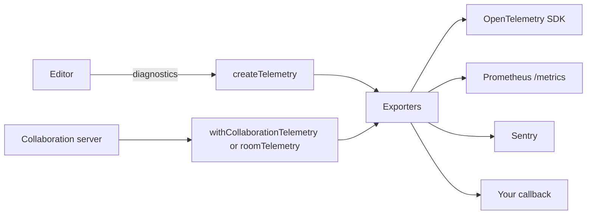

`@docx-editor.dev/telemetry` sends the editor's anonymous [diagnostics](/docs/2.x/guides/diagnostics) and metrics to the observability tools that you already run. It covers single-user editors, collaboration clients, and collaboration servers.

The package sends nothing by itself. You choose the exporters, and you choose the areas to record. Every event contains only codes, booleans, bucketed sizes and counts, and timings. Document text, file names, part names, author names, font names, and room names are never sent.



## Choose a standard

| Need | Use | Entry point |
| --- | --- | --- |
| Metrics and traces in any backend that accepts OTLP, such as Datadog, Grafana, Honeycomb, or New Relic | OpenTelemetry, through your own SDK | `@docx-editor.dev/telemetry/otel` |
| A scrape endpoint for Prometheus or Grafana Agent | Prometheus text format | `@docx-editor.dev/telemetry/prometheus` |
| Grouped error issues for editor and server-agent failures | Sentry | `@docx-editor.dev/telemetry/sentry` |
| Any other tool, such as Datadog RUM, PostHog, or your logger | A callback | `@docx-editor.dev/telemetry` |

OpenTelemetry is the source model. Prometheus names come from the OpenTelemetry names: `docx_editor.collab.room.load.duration` in seconds becomes `docx_editor_collab_room_load_duration_seconds`.

## Install

```bash
npm install @docx-editor.dev/telemetry
```

Install the peer dependency for each exporter that you use: `@opentelemetry/api` for OpenTelemetry, `yjs` with `@docx-editor.dev/pro` for room telemetry, and `@hocuspocus/server` 4.6 or later for the Hocuspocus integration. The Sentry and Prometheus exporters have no dependencies.

## Set up an editor

Create the telemetry client once, outside your components, and register its module. The module receives the diagnostics of the first document that the editor opens.

```tsx
// telemetry.ts
import { createTelemetry } from '@docx-editor.dev/telemetry';
import { sentryExporter } from '@docx-editor.dev/telemetry/sentry';
import * as Sentry from '@sentry/react';

export const telemetry = createTelemetry({
  exporters: [sentryExporter(Sentry)],
  include: { documentOpen: true, trackedChanges: true, editing: true },
  consent: () => consentManager.analytics === true, // your consent manager
  resource: { 'service.name': 'contracts-app' },
});
```

```tsx
// Editor.tsx
import { DocxEditor } from '@docx-editor.dev/react';
import { reviewModule } from '@docx-editor.dev/pro';
import { telemetry } from './telemetry';

const MODULES = [reviewModule(), telemetry.module];

export function Editor({ bytes }: { bytes: Uint8Array }) {
  return <DocxEditor document={bytes} modules={MODULES} />;
}
```

In Vue, pass the same array: `<DocxEditor :document="bytes" :modules="MODULES" />`.

If you pass `consent`, nothing is sent while it returns `false`, and events from that time are dropped, not buffered. If you omit `consent`, events are sent. The function runs only when an event is recorded, so the client is safe to create during server rendering.

Register `telemetry.module`, or call `telemetry.record(event)` yourself, but not both. If you do both, every event is recorded twice.

### Choose what to record

The `include` option turns areas on. If you omit `include`, every area is on.

| Area | Records |
| --- | --- |
| `documentOpen` | Documents that opened, with size and page buckets and the open time, and documents that were refused, with the reason. |
| `editing` | Edits and commands that were refused while changes were not tracked. |
| `trackedChanges` | Edits that were refused while suggesting, refusals about tracking itself (such as a missing author or protection that allows only tracked changes), and tracked changes that accept, reject, or reassign requests skipped. |
| `fonts` | Fonts that failed to load and were substituted. |
| `history` | Undo steps that did not group as the gesture intended. |
| `customNodes` | Custom node payloads that could not be read. |
| `collaborationClient` | Collaboration status changes, failure codes, connect time, and the number of people in the room. |

Each area accepts `{ sampleRate }`, from 0 to 1. Sampling applies to events only; metrics count every event.

By default, an opened document is described by its size and page buckets. To also send its part, paragraph, review item, and embedded font buckets, set `documentShape: 'detailed'`. Several counts together describe a document more closely, so turn it on only when you need it.

Identical refusals within 10 seconds are sent once. When the window closes, one summary event repeats the first event with `repeated` set to the number of extra events. Count a summary; do not treat it as a new failure. For the number of people in a room, only the latest count in the window is sent. A collaboration status that repeats, such as a connection that drops again and again, is also sent once per window. To change the window, set `dedupeWindowMs`.

### See why an edit failed during development

Add `consoleExporter()` to print each event with its hint and documentation link:

```ts
import { createTelemetry, consoleExporter } from '@docx-editor.dev/telemetry';

export const telemetry = createTelemetry({ exporters: [consoleExporter()] });
```

If an agent deletes a picture through the editing API while changes are tracked, the console prints the following output:

```text
[docx-editor] edit refused: edit.tracked-operation-unsupported (automation, tracked)
  This editing API operation cannot be recorded as a tracked change, so nothing was applied. Use text edits such as range.insertText or range.delete, which tracking records. Never switch tracking off to make the edit succeed.
  https://docx-editor.dev/docs/2.x/guides/diagnostics#edit-tracked-operation-unsupported
```

## Send to Sentry

`sentryExporter` accepts the Sentry module of any Sentry JavaScript SDK. An open your app caused or the engine could not explain, a collaboration error that does not heal, a text shaper that did not load, and an engine invariant become Sentry issues. A corrupt or oversized file becomes a breadcrumb, because the app cannot fix the file. An expired collaboration token and a room the server compacted are breadcrumbs too, because the client rejoins. The fingerprint is the diagnostic code, so issues group by cause. Other events become breadcrumbs, which appear next to your own errors and do not use your event quota.

To change which events become issues, pass `issue: (event) => boolean`.

Sentry records more of the page than your diagnostics. Session Replay records the page, and the page shows the document. Each click and key press becomes a breadcrumb that describes the element with its `alt`, `title`, and `aria-label` values, which inside the editor come from the document. Block the editor in Replay, and drop the editor's click and key press breadcrumbs:

```ts
import { dropEditorBreadcrumbs, EDITOR_SELECTORS } from '@docx-editor.dev/telemetry/sentry';

Sentry.init({
  dsn: '...',
  integrations: [Sentry.replayIntegration({ block: [...EDITOR_SELECTORS] })],
  beforeBreadcrumb: dropEditorBreadcrumbs,
});
```

Sentry also attaches the page URL to every event. If your URLs contain a document, matter, or client identifier, remove it in `beforeSend`. Sentry records console messages as breadcrumbs by default; drop the `console` category in `beforeBreadcrumb` if your own code logs document details.

## Send to OpenTelemetry

The exporter uses the global meter and tracer providers unless you pass your own, and it reads them at each use. You can create it before your OpenTelemetry SDK starts; measurements reach the SDK from the moment it registers.

```ts
import { createTelemetry } from '@docx-editor.dev/telemetry';
import { otelExporter } from '@docx-editor.dev/telemetry/otel';

export const telemetry = createTelemetry({ exporters: [otelExporter()] });
```

Each document open becomes a `docx_editor.document.open` span. The span has an error status when the open is refused. Other events are added to the active span. If there is no active span, as is usual in a browser, a failure gets a short span of its own. In development, the exporter warns once if no SDK is registered.

## Send to another tool

Use `callbackExporter` to forward events to any function:

```ts
import { callbackExporter, createTelemetry, isFailure } from '@docx-editor.dev/telemetry';

export const telemetry = createTelemetry({
  exporters: [
    // isFailure is false for expected refusals and for deduplication summaries.
    callbackExporter((event) =>
      isFailure(event)
        ? datadogRum.addError(new Error(event.kind), event)
        : datadogRum.addAction(event.kind, event)
    ),
  ],
});
```

To write your own exporter, implement `TelemetryExporter` with an `event` method, a `metric` method, or both.

## Set up a server agent

A runtime from `DocxEditor.createServer` reports the same diagnostics as an editor: the open, and each refused batch with its code. A refusal under a tracking mode the batch set itself counts as tracked. Create one telemetry client per process and pass its module to every runtime:

```ts
import { DocxEditor } from '@docx-editor.dev/editor-api';
import { createTelemetry } from '@docx-editor.dev/telemetry';
import { otelExporter } from '@docx-editor.dev/telemetry/otel';

const telemetry = createTelemetry({ exporters: [otelExporter()] });

const runtime = await DocxEditor.createServer(bytes, {
  author: 'Review agent',
  modules: [telemetry.module],
});
try {
  // ...run the agent...
} finally {
  runtime.dispose();
}
```

In a long-running worker, call `await telemetry.shutdown()` once, when the process exits. In a serverless function or a one-shot job, call `await telemetry.flush()` before it returns, so buffered data is sent. Do not flush after every job in a long-running worker: it forces an export each time and closes the deduplication windows of every other job.

The `editorSessionId` value is different for each runtime, so you can follow one agent run. A runtime from `DocxEditor.createBrowser` reports its refused batches into the diagnostics of the editor it borrows, with `origin: 'automation'`, so the editor's telemetry module covers in-browser agents too.

On a server, the Sentry Node SDK can attach the incoming request body to an issue. If an agent endpoint receives instructions or document bytes, remove `event.request.data` in `beforeSend`. A refused batch also explains itself in `error.debugInfo.innerError`. For more information, see [Batching, loading, and errors](/docs/2.x/editor-api/batching-and-errors).

## Set up a collaboration server

### Hocuspocus

Wrap your Hocuspocus configuration. The wrapper adds one extension that runs before all others, so it times each load and store across every extension and hook. It also observes your hooks and the extensions in `extensions`, and records why one of them refused a connection or a message. Your hooks and extensions keep their arguments, return values, and errors. Extensions added later with `server.configure` are not observed. The telemetry flushes when Hocuspocus shuts down, so do not add your own signal handler for it. It requires `@hocuspocus/server` 4.6 or later.

```ts
import { Server } from '@hocuspocus/server';
import { withCollaborationTelemetry } from '@docx-editor.dev/telemetry/hocuspocus';
import { metricsHandler, prometheusRegistry } from '@docx-editor.dev/telemetry/prometheus';

const metrics = prometheusRegistry();
const { config, rooms } = withCollaborationTelemetry(
  { port: 1234, onAuthenticate, onLoadDocument, beforeHandleMessage, onStoreDocument },
  { exporters: [metrics] }
);
const server = new Server(config);

app.get('/metrics', metricsHandler(metrics));
app.get('/admin/rooms', requireAdmin, (_request, response) => response.json(rooms.list()));
```

If the server has no web framework, serve the metrics from the Hocuspocus HTTP server with `serveMetrics`:

```ts
import { requireBearerToken, serveMetrics } from '@docx-editor.dev/telemetry/hocuspocus';

const server = new Server({
  ...config,
  onRequest: serveMetrics(metrics, {
    rooms: { telemetry: rooms, path: '/rooms' },
    // Throws at startup when METRICS_TOKEN is empty, so the endpoint never opens by accident.
    authorize: requireBearerToken(process.env.METRICS_TOKEN),
  }),
});
```

Pass every hook in the configuration you wrap. A hook set later, for example in the object you pass to `new Server`, is not observed.

`serveMetrics` requires `authorize` when it serves the room list. To keep your own `onRequest`, pass it as `next`; `serveMetrics` calls it for every other path. The reason of a refusal is read from the error's `reason` property, then its `code`. It becomes a metric label only when it is a collaboration failure code, a common reason such as `unauthorized`, `forbidden`, `permission-denied`, `unknown-room`, or `rate-limited`, or a reason you list in the `reasons` option. Any other reason is counted as `other`, so free text never becomes a label. Hocuspocus's `Unauthorized` and `Forbidden` close events, and an error whose message is a common reason, such as `new Error('Unauthorized')`, count as that reason. A bare `throw` with no error counts as `permission-denied`, which is what Hocuspocus tells the client. An error with no reason, often a bug in the hook, counts as `other`. If your errors carry free text, map them with `reasonOf`: return a common reason, a collaboration failure code, or a value you list in `reasons`. Refusals thrown in `onConnect`, `onAuthenticate`, and `onTokenSync` are counted as admission refusals.

On the server, Hocuspocus writes each hook error message to the console, and Sentry's Node SDK records console output as breadcrumbs by default. Drop the `console` category in `beforeBreadcrumb` if those messages can name a user or a room.

Room telemetry sends metrics only. Use `otelExporter` or `prometheusRegistry` on a server; an exporter without a `metric` method, such as `sentryExporter`, receives nothing there, and the server warns at startup.

### Other Yjs servers

Use `roomTelemetry` and call it from your own room lifecycle:

```ts
import { roomTelemetry } from '@docx-editor.dev/telemetry/server';

const rooms = roomTelemetry({ exporters: [metrics] });

const room = rooms.open(ydoc, { name: roomName, awareness });
// Load through the handle: the saved state it applies is not counted as new edits.
await room.time('load', () => loadRoom(ydoc));
room.connected();
// When that connection closes:
room.disconnected();
// When a connection is refused at admission:
rooms.rejected(error);
// When the server unloads the room:
room.close();
```

### People and memory in each room

The number of people in a room comes from the room's awareness states. One person with two tabs counts twice. If you run several Hocuspocus instances with the Redis extension, each instance sees the people of every instance in its awareness, so do not add the instances together. With `perRoomSeries`, take the `max` for each room across instances and add the rooms. Without per-room series, the `max` across instances is exact only when every instance holds the same rooms; otherwise it is a lower bound. Connections are counted separately, as one per socket and room.

JavaScript cannot measure the heap used by one room. The metrics report what each room holds instead: the encoded Yjs state, the stored images and other files, and the updates not yet stored. To see whether process memory grows with the rooms, compare these metrics with your process memory metrics, such as `prom-client` default metrics.

The state is encoded once per sample, and only for rooms that changed. The interval sample handles one room at a time and yields between rooms, so many large rooms do not block other work. To skip encoding entirely, set `measureState: false`. The default sample interval is 60 seconds. To sample once per scrape instead, set `sampleInterval: false` and call `rooms.sample()` before you render the metrics, or pass `sampleBeforeScrape: rooms` to `serveMetrics`.

### Per-room detail

Metrics carry no room name, so the number of series stays bounded and names stay private. Values such as people and memory per room are histograms: each sample adds every room once. Query them over a window, such as `histogram_quantile(0.95, rate(docx_editor_collab_room_memory_bytes_bucket[5m]))`, or divide `rate(..._sum[5m])` by `rate(..._count[5m])` for the mean. To find a large room, call `rooms.list()` from an endpoint that only administrators can reach. Each row has the room label, people, connections, state bytes, file bytes, pending bytes, node count, the largest share of any room limit, age, and idle time.

By default, the room label is an index that is valid only in the current process, such as `room-3`. To get a stable label that does not reveal the name, use `roomLabel: hmacRoomLabel(process.env.ROOM_LABEL_SECRET)`. It throws at startup when the secret is empty. To show real names, use `roomLabel: (name) => name`.

### Label metrics by room

If a few rooms need their own series, set `perRoomSeries: true`, with the default label or `roomLabel: hmacRoomLabel(secret)`. Any other `roomLabel` throws, so a room name cannot become a label. Each room then gets `docx_editor_collab_room_participants_current` and `docx_editor_collab_room_memory_current_bytes` gauges labeled `room`. A closed room's series are removed. Each room adds series, so keep this off on servers with many rooms.

### Serve Prometheus metrics

`metricsHandler` serves Node-style servers, such as Node `http` and Express. `fetchMetricsHandler` serves Fetch-style servers, such as Next.js route handlers, Hono, Bun, and Deno. To serve your `prom-client` metrics from the same endpoint, pass `merge: [register]` to either one.

```ts
// Next.js: app/metrics/route.ts
import { fetchMetricsHandler } from '@docx-editor.dev/telemetry/prometheus';
import { metrics } from '@/lib/metrics';

export const dynamic = 'force-dynamic'; // never serve cached metrics
export const GET = fetchMetricsHandler(metrics);
```

For Fastify, call `reply.hijack()` and pass the raw Node objects. Without `hijack()`, Fastify tries to send a second response after the handler ends it.

```ts
fastify.get('/metrics', (request, reply) => {
  reply.hijack();
  return metricsHandler(metrics)(request.raw, reply.raw);
});
```

## Privacy

- Every diagnostic is built from closed lists of codes, booleans, and bucketed numbers. The engine creates it this way, and the package checks each event again before an exporter receives it.
- Hints and documentation links are fixed text for each code.
- Sizes and counts are buckets, such as `4-8MiB` or `10-99`.
- The `editorSessionId` value is random for each editor instance and is never stored.
- Metric labels accept only short identifier values. Any other value becomes `other`.
- Room names never appear in metrics.
- The `resource` values are yours. Do not put a user, a document, or a room name in them.

## Metrics

| Prometheus name | Type | Labels | Description |
| --- | --- | --- | --- |
| `docx_editor_document_opens_total` | counter | `outcome`, `code` | Documents opened or refused, by outcome and refusal code. |
| `docx_editor_document_open_duration_seconds` | histogram | none | Time from the start of an open to the laid-out document. |
| `docx_editor_edit_rejections_total` | counter | `code`, `origin`, `tracked` | Edits, commands, and tracked changes refused, by public code. |
| `docx_editor_review_skipped_total` | counter | `code` | Tracked changes skipped by accept, reject, or reassign requests. |
| `docx_editor_font_failures_total` | counter | `code` | Font faces that failed to load and were substituted. |
| `docx_editor_history_diagnostics_total` | counter | `code` | Undo steps that did not group as the gesture intended, by code. |
| `docx_editor_custom_node_diagnostics_total` | counter | `code` | Custom node payloads that could not be read, by code. |
| `docx_editor_collab_client_status_transitions_total` | counter | `status`, `code` | Collaboration status changes on clients, by new status and failure code. |
| `docx_editor_collab_client_connect_duration_seconds` | histogram | none | Time from joining a room to the first ready status. |
| `docx_editor_collab_client_participants` | histogram | none | People in the room, as each client sees it when the count changes. |
| `docx_editor_telemetry_dropped_events_total` | counter | `reason` | Events the anonymity guard dropped, by reason. Usually a version mismatch. |
| `docx_editor_collab_rooms_active` | gauge | none | Rooms loaded. |
| `docx_editor_collab_connections_active` | gauge | none | Open client connections. One person with two tabs is two connections. |
| `docx_editor_collab_participants_active` | gauge | none | People present in all rooms, from awareness states. |
| `docx_editor_collab_room_participants` | histogram | none | People present in each room, sampled once per room per interval. |
| `docx_editor_collab_room_participants_max` | gauge | none | People in the fullest room at the last sample. |
| `docx_editor_collab_room_memory_bytes` | histogram | `kind` | Bytes each room holds, sampled per room: encoded state, blobs, and updates not yet stored. |
| `docx_editor_collab_rooms_memory_bytes` | gauge | `kind` | Bytes all rooms hold together at the last sample. |
| `docx_editor_collab_room_nodes` | histogram | `state` | Shared document nodes per room, live and tombstoned. |
| `docx_editor_collab_room_resource_usage` | histogram | `resource` | Share of each room resource limit in use, from 0 to 1. |
| `docx_editor_collab_room_age_seconds` | histogram | none | How long each room has been loaded. |
| `docx_editor_collab_room_idle_seconds` | histogram | none | Time since each room last changed. |
| `docx_editor_collab_room_load_duration_seconds` | histogram | `outcome` | Time to load a room, by outcome. |
| `docx_editor_collab_room_store_duration_seconds` | histogram | `outcome` | Time to store a room, by outcome. |
| `docx_editor_collab_admission_rejections_total` | counter | `reason` | Connections refused at admission, by reason. |
| `docx_editor_collab_message_refusals_total` | counter | `reason` | Messages refused before they applied, by reason, such as room-generation-changed. |
| `docx_editor_collab_updates_total` | counter | none | Document updates applied to rooms. |
| `docx_editor_collab_update_bytes_total` | counter | none | Bytes of document updates applied to rooms. |
| `docx_editor_collab_room_participants_current` | gauge | `room` | People in each room, labeled by room. Recorded only with perRoomSeries. |
| `docx_editor_collab_room_memory_current_bytes` | gauge | `room`, `kind` | Bytes each room holds, labeled by room and kind. Recorded only with perRoomSeries. |
| `docx_editor_collab_migrations_total` | counter | `outcome` | Room migrations, by outcome. |
