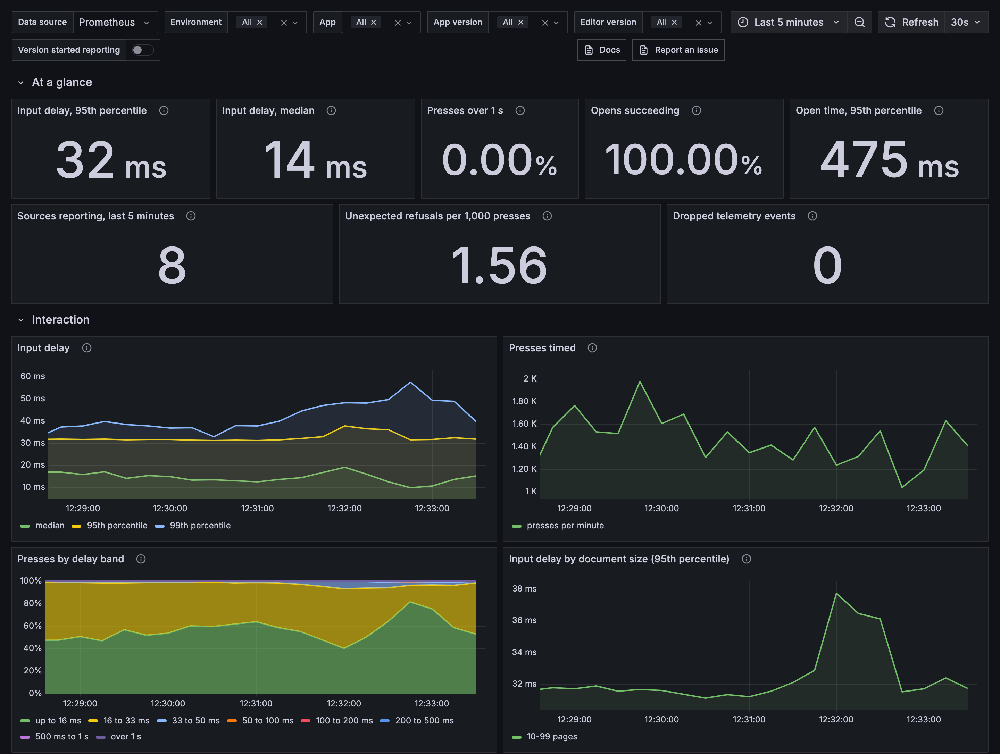

<Callout>`@docx-editor.dev/telemetry` is available in version 2.29.0 and later.</Callout>

Two Grafana dashboards report editor performance and collaboration server activity. They have no predefined targets. Use a few weeks of your traffic to set targets and alert thresholds.

## Download the dashboards

The following commands download both dashboards:

```bash
BASE=https://raw.githubusercontent.com/eigenpal/docx-editor/main/assets/observability
curl -LO "$BASE/grafana/editor-experience.json"
curl -LO "$BASE/grafana/collaboration.json"
```

| File | Panels |
| --- | --- |
| [`editor-experience.json`](https://raw.githubusercontent.com/eigenpal/docx-editor/main/assets/observability/grafana/editor-experience.json) | Input delay, engine work, opens, sessions, edits, saves, and refused edits and tracked changes. |
| [`collaboration.json`](https://raw.githubusercontent.com/eigenpal/docx-editor/main/assets/observability/grafana/collaboration.json) | Server state, rooms and people, memory, server work, client status, and refusals. |

The [observability assets directory](https://github.com/eigenpal/docx-editor/tree/main/assets/observability) also holds the generation script.

## Supply required metrics and labels

The dashboards read Prometheus-compatible metrics. Editor metrics reach Prometheus through your OpenTelemetry SDK and an OpenTelemetry Protocol (OTLP) collector or receiver. Server metrics come from the `/metrics` endpoint described in [Collaboration servers](/docs/2.x/telemetry/servers).

The following client records every area the panels read and adds the filter labels:

```ts
import { createTelemetry } from '@docx-editor.dev/telemetry';
import { otelExporter } from '@docx-editor.dev/telemetry/otel';

export const telemetry = createTelemetry({
  exporters: [otelExporter()],
  include: {
    documentOpen: true,
    documentSave: true,
    sessions: true,
    editing: true,
    trackedChanges: true,
    fonts: true,
    performance: true,
    // Only in apps with collaboration: the client panels of the Collaboration dashboard.
    collaborationClient: true,
  },
  attributes: { 'deployment.environment': 'production', 'app.version': '4.2.0' },
  metricLabels: ['deployment.environment', 'app.version'],
});
```

| Label | Comes from |
| --- | --- |
| `job` | `service.name` on your OpenTelemetry SDK, or your server's scrape job. |
| `deployment_environment` | `deployment.environment` in `attributes` and `metricLabels`. |
| `app_version` | `app.version` in `attributes` and `metricLabels`. |
| `docx_editor_version` | Added by the telemetry package to every editor metric. |
| `docx_editor` | The scrape target label that marks a collaboration server. |

Add the `docx_editor` target label to each collaboration server. Server panels show only labeled targets, including servers that fail every scrape:

```yaml
scrape_configs:
  - job_name: collaboration-server
    static_configs:
      - targets: ['collaboration.internal:1235']
        labels:
          docx_editor: collaboration
```

Client panels use editor metrics and respond only to the **Client app** filter.

## Import into Grafana

1. Go to **Dashboards** > **New** > **Import**, and upload `editor-experience.json`.
2. Repeat for `collaboration.json`.
3. In each dashboard, select your Prometheus source in **Data source**.
4. Select **App** and **Environment**. On **Collaboration**, select the **Server** job and its instances.



Every code in a dashboard table links to its hint in [Diagnostics](/docs/2.x/guides/diagnostics).

## Interpret missing or capped values

| Panel shows | Meaning |
| --- | --- |
| No input delay or layout value | Fewer than 20 samples in the window. |
| No open-time value | Fewer than 5 opens in the window. |
| A percentile of 1 second | The value falls in the overflow band above 1 second, the highest finite boundary. Use **Presses by delay band**. |

Percentiles are estimates from timing bands. A value from few samples follows one slow press or one large file.

## Query the metrics

The following Prometheus queries give sessions per day, active editing hours per day, edit failure rate, and save success rate:

```text
sum(increase(docx_editor_editor_sessions_total{phase="start"}[1d]))

sum(increase(docx_editor_editor_active_time_seconds_total[1d])) / 3600

sum(increase(docx_editor_edit_rejections_total[1d]))
  / (sum(increase(docx_editor_edits_total[1d])) + sum(increase(docx_editor_edit_rejections_total[1d])))

sum(increase(docx_editor_document_saves_total{outcome="saved"}[1d]))
  / sum(increase(docx_editor_document_saves_total[1d]))
```

`sum(rate(docx_editor_editor_active_time_seconds_total[5m]))` approximates the number of people editing at once.

The following queries estimate the 95th percentile input delay per page bucket, and the share of presses over 200 ms:

```text
histogram_quantile(0.95, sum by (le, pages) (rate(docx_editor_editor_interaction_duration_seconds_bucket[10m])))

1 - sum(rate(docx_editor_editor_interaction_duration_seconds_bucket{le="0.2"}[10m]))
  / sum(rate(docx_editor_editor_interaction_duration_seconds_count[10m]))
```

Per-room histograms record one entry per room in each sample. The following queries give the 95th percentile and the mean room memory:

```text
histogram_quantile(0.95, rate(docx_editor_collab_room_memory_bytes_bucket[5m]))

rate(docx_editor_collab_room_memory_bytes_sum[5m])
  / rate(docx_editor_collab_room_memory_bytes_count[5m])
```

## Limits

- With the Redis extension, instances that share rooms report overlapping participants. Never sum participants across them.
- Selecting one instance is exact only when every instance holds the same rooms. Otherwise it gives a lower bound. For per-room aggregation, see [Rooms, people, and memory](/docs/2.x/telemetry/rooms).
- The [telemetry stack example](https://github.com/eigenpal/docx-editor/tree/main/examples/telemetry-stack) runs a collector, Prometheus, Jaeger, and Grafana with these dashboards and simulated activity.

## See also

- [Metrics](/docs/2.x/telemetry/metrics)
- [Send to OpenTelemetry](/docs/2.x/telemetry/opentelemetry)
- [Collaboration servers](/docs/2.x/telemetry/servers)
