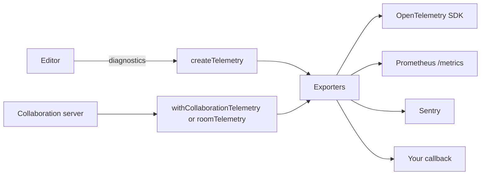

<Callout>`@docx-editor.dev/telemetry` is available in version 2.29.0 and later.</Callout>

`@docx-editor.dev/telemetry` sends anonymous [diagnostics](/docs/2.x/guides/diagnostics) and metrics to your monitoring tools. It covers single-user editors, collaboration clients, and collaboration servers.

Configure exporters to send data, and choose which areas to record. Built-in diagnostics contain codes, booleans, bucketed sizes and counts, and timings. They exclude document text, file names, part names, author names, font names, and room names. You control any attributes you add and any data your monitoring SDKs collect.



## Choose an exporter

| Need | Use | Entry point |
| --- | --- | --- |
| Metrics and traces in any backend that accepts OTLP, such as Datadog, Grafana, Honeycomb, or New Relic | OpenTelemetry, through your own SDK | `@docx-editor.dev/telemetry/otel` |
| A scrape endpoint for Prometheus or Grafana Agent | Prometheus text format | `@docx-editor.dev/telemetry/prometheus` |
| Grouped error issues for editor and server-agent failures | Sentry | `@docx-editor.dev/telemetry/sentry` |
| A log service over HTTP, such as Better Stack, Axiom, or Datadog Logs | An HTTP exporter and a route on your server | `@docx-editor.dev/telemetry` and `@docx-editor.dev/telemetry/ingest` |
| Any other tool, such as Datadog RUM, PostHog, or your logger | A callback | `@docx-editor.dev/telemetry` |

Metrics use the OpenTelemetry model. Prometheus metric names replace dots with underscores and include units: `docx_editor.collab.room.load.duration` in seconds becomes `docx_editor_collab_room_load_duration_seconds`.

## Install

```bash
npm install @docx-editor.dev/telemetry @docx-editor.dev/core
```

Install the peer dependencies for the integrations you use:

- OpenTelemetry: `@opentelemetry/api`.
- Room telemetry: `yjs` and `@docx-editor.dev/pro`.
- Hocuspocus: `@hocuspocus/server` 4.6 or later.

The Sentry exporter uses your app's Sentry SDK. The Prometheus exporter has no dependencies. Editor apps also need `@docx-editor.dev/react` or `@docx-editor.dev/vue`. Add `@docx-editor.dev/pro` for review and collaboration.

## Privacy

- The package never sends data by itself. It sends only to the exporters you configure.
- Diagnostics use fixed sets of codes, booleans, bucketed sizes and counts, and timings. Document text, file and part names, author names, font names, and exception messages are never included.
- The engine builds each event this way, and the package checks each event again before an exporter receives it.
- You control identifiers in `attributes`, `resource`, and `metricLabels`. You also control what your Sentry and OpenTelemetry SDKs collect.

For fields and validation rules, see [Privacy](/docs/2.x/telemetry/privacy). To review your settings, see [Privacy review checklist](/docs/2.x/telemetry/privacy-review).

## Where to start

Review data collection, set up your editor, then choose a destination. Use the other guides for specific tasks.

1. [Privacy](/docs/2.x/telemetry/privacy): what is sent and what is never sent. Start here for a privacy review, then complete the [Privacy review checklist](/docs/2.x/telemetry/privacy-review).
2. [Set up an editor](/docs/2.x/telemetry/editors): create the client, register its module, and choose what to record.
3. Send the data to your backend:
   - [Send to Sentry](/docs/2.x/telemetry/sentry) for grouped issues.
   - [Send to OpenTelemetry](/docs/2.x/telemetry/opentelemetry) for metrics and traces in Grafana, Datadog, or Honeycomb.
   - [Send to a log service](/docs/2.x/telemetry/log-services) for Better Stack or any HTTP log intake. For Axiom and Datadog Logs, see [Other log services](/docs/2.x/telemetry/log-recipes).
   - [Send to your own code](/docs/2.x/telemetry/callbacks) for Datadog RUM, PostHog, or your own logger.
4. Optional:
   - [Measure performance](/docs/2.x/telemetry/performance): how fast typing and layout feel.
   - [Measure sessions, edits, and saves](/docs/2.x/telemetry/sessions): how many people edit, for how long, and how often edits and saves fail.
   - [Identify rooms and users](/docs/2.x/telemetry/identifiers): your own identifiers, and thousands of open editors.
   - [Server agents](/docs/2.x/telemetry/agents): agents that use the editing API.
   - [Collaboration servers](/docs/2.x/telemetry/servers): set up metrics on your server. Then read [Rooms, people, and memory](/docs/2.x/telemetry/rooms) for what the room metrics mean.
5. Monitor your app with [Dashboards](/docs/2.x/telemetry/dashboards). For metric names and labels, see [Metrics](/docs/2.x/telemetry/metrics).

For every diagnostic code and its hint, see [Diagnostics](/docs/2.x/guides/diagnostics). For complete setups, see the [single-user example](https://github.com/eigenpal/docx-editor/tree/main/examples/telemetry-single-user), the [collaboration example](https://github.com/eigenpal/docx-editor/tree/main/examples/telemetry-collaboration), and the [dashboards stack](https://github.com/eigenpal/docx-editor/tree/main/examples/telemetry-stack).
