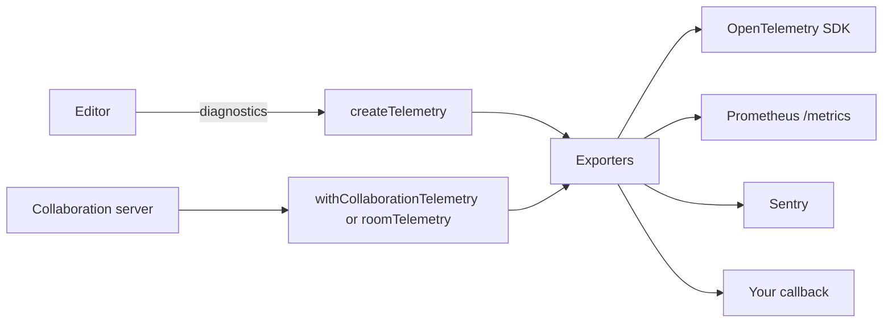

<Callout>`@docx-editor.dev/telemetry` is available in version 2.29.0 and later.</Callout>

`@docx-editor.dev/telemetry` sends the editor's anonymous [diagnostics](/docs/2.x/guides/diagnostics) and metrics to the observability tools that you already run. It covers single-user editors, collaboration clients, and collaboration servers.

The package sends nothing by itself. You choose the exporters, and you choose the areas to record. Every event contains only codes, booleans, bucketed sizes and counts, and timings. Document text, file names, part names, author names, font names, and room names are never sent.



## Choose a standard

| Need | Use | Entry point |
| --- | --- | --- |
| Metrics and traces in any backend that accepts OTLP, such as Datadog, Grafana, Honeycomb, or New Relic | OpenTelemetry, through your own SDK | `@docx-editor.dev/telemetry/otel` |
| A scrape endpoint for Prometheus or Grafana Agent | Prometheus text format | `@docx-editor.dev/telemetry/prometheus` |
| Grouped error issues for editor and server-agent failures | Sentry | `@docx-editor.dev/telemetry/sentry` |
| A log service over HTTP, such as Better Stack, Axiom, or Datadog Logs | An HTTP exporter and a route on your server | `@docx-editor.dev/telemetry` and `@docx-editor.dev/telemetry/ingest` |
| Any other tool, such as Datadog RUM, PostHog, or your logger | A callback | `@docx-editor.dev/telemetry` |

OpenTelemetry is the source model. Prometheus names come from the OpenTelemetry names: `docx_editor.collab.room.load.duration` in seconds becomes `docx_editor_collab_room_load_duration_seconds`.

## Install

```bash
npm install @docx-editor.dev/telemetry @docx-editor.dev/core
```

Install the peer dependency for each exporter that you use: `@opentelemetry/api` for OpenTelemetry, `yjs` with `@docx-editor.dev/pro` for room telemetry, and `@hocuspocus/server` 4.6 or later for the Hocuspocus integration. The Sentry exporter takes the Sentry SDK your app already loads, and the Prometheus exporter has no dependencies. In an editor app, you also have `@docx-editor.dev/react` or `@docx-editor.dev/vue`, and `@docx-editor.dev/pro` for review and collaboration.

## Privacy

- The package never sends data by itself. It sends only to the exporters you configure.
- Every diagnostic is built from closed lists of codes, booleans, bucketed sizes and counts, and timings. Document text, file and part names, author names, font names, and exception messages are never included.
- The engine builds each event this way, and the package checks each event again before an exporter receives it.
- The identifiers you add with `attributes`, `resource`, and `metricLabels`, and what your Sentry and OpenTelemetry SDKs collect, are yours to control.

For every field that can be sent, how the rules are enforced, and a review checklist, see [Privacy](/docs/2.x/telemetry/privacy).

## Where to start

Read the pages in this order. Each one is short and covers one task.

1. [Privacy](/docs/2.x/telemetry/privacy): what is sent and what is never sent. Start here for a privacy review.
2. [Set up an editor](/docs/2.x/telemetry/editors): create the client, register its module, and choose what to record.
3. Send the data to your backend:
   - [Send to Sentry](/docs/2.x/telemetry/sentry) for grouped issues.
   - [Send to OpenTelemetry](/docs/2.x/telemetry/opentelemetry) for metrics and traces in Grafana, Datadog, or Honeycomb.
   - [Send to a log service](/docs/2.x/telemetry/log-services) for Better Stack, Axiom, Datadog Logs, or your own function.
4. Optional:
   - [Measure performance](/docs/2.x/telemetry/performance): how fast typing and layout feel.
   - [Identify rooms and users](/docs/2.x/telemetry/identifiers): your own identifiers, and thousands of open editors.
   - [Server agents](/docs/2.x/telemetry/agents): agents that use the editing API.
   - [Collaboration servers](/docs/2.x/telemetry/servers): rooms, people, and memory on your server.
5. Watch it: [Dashboards](/docs/2.x/telemetry/dashboards) to download, and [Metrics](/docs/2.x/telemetry/metrics) for every name and label.

For every diagnostic code and its hint, see [Diagnostics](/docs/2.x/guides/diagnostics). To run working setups, see the [one-person example](https://github.com/eigenpal/docx-editor/tree/main/examples/telemetry-single-user), the [collaboration example](https://github.com/eigenpal/docx-editor/tree/main/examples/telemetry-collaboration), and the [dashboards stack](https://github.com/eigenpal/docx-editor/tree/main/examples/telemetry-stack).
