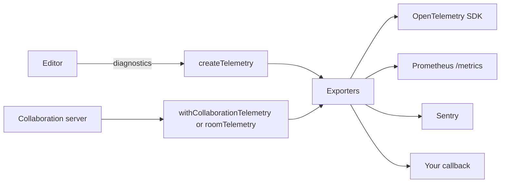

`@docx-editor.dev/telemetry` sends the editor's anonymous [diagnostics](/docs/2.x/guides/diagnostics) and metrics to the observability tools that you already run. It covers single-user editors, collaboration clients, and collaboration servers.

The package sends nothing by itself. You choose the exporters, and you choose the areas to record. Every event contains only codes, booleans, bucketed sizes and counts, and timings. Document text, file names, part names, author names, font names, and room names are never sent.



## Choose a standard

| Need | Use | Entry point |
| --- | --- | --- |
| Metrics and traces in any backend that accepts OTLP, such as Datadog, Grafana, Honeycomb, or New Relic | OpenTelemetry, through your own SDK | `@docx-editor.dev/telemetry/otel` |
| A scrape endpoint for Prometheus or Grafana Agent | Prometheus text format | `@docx-editor.dev/telemetry/prometheus` |
| Grouped error issues for editor and server-agent failures | Sentry | `@docx-editor.dev/telemetry/sentry` |
| Any other tool, such as Datadog RUM, PostHog, or your logger | A callback | `@docx-editor.dev/telemetry` |

OpenTelemetry is the source model. Prometheus names come from the OpenTelemetry names: `docx_editor.collab.room.load.duration` in seconds becomes `docx_editor_collab_room_load_duration_seconds`.

## Install

```bash
npm install @docx-editor.dev/telemetry @docx-editor.dev/core
```

Install the peer dependency for each exporter that you use: `@opentelemetry/api` for OpenTelemetry, `yjs` with `@docx-editor.dev/pro` for room telemetry, and `@hocuspocus/server` 4.6 or later for the Hocuspocus integration. The Sentry and Prometheus exporters have no dependencies.

## Privacy

- Every diagnostic is built from closed lists of codes, booleans, and bucketed numbers. The engine creates it this way, and the package checks each event again before an exporter receives it.
- Hints and documentation links are fixed text for each code.
- Sizes and counts are buckets, such as `4-8MiB` or `10-99`.
- Performance summaries hold counts and milliseconds only. No key, position, or text is recorded.
- The `editorSessionId` value is random for each editor instance and is never stored.
- Metric labels accept only short identifier values. Any other value becomes `other`.
- Room names never appear in metrics.
- The `resource` values are yours. Do not put a user, a document, or a room name in them.

## Next steps

- To record diagnostics from editors and agents, see [Editors and agents](/docs/2.x/telemetry/editors).
- To record rooms, people, and memory on a collaboration server, see [Collaboration servers](/docs/2.x/telemetry/servers).
- For every metric name, type, and label, see [Metrics](/docs/2.x/telemetry/metrics).
- For every diagnostic code and its hint, see [Diagnostics](/docs/2.x/guides/diagnostics).
