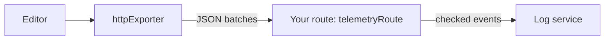

<Callout>`@docx-editor.dev/telemetry` is available in version 2.29.0 and later.</Callout>

Use this setup when you send telemetry to a log service over HTTP, such as Better Stack, Axiom, or Datadog Logs, instead of through an OpenTelemetry SDK. It has two parts:

1. In the browser, `httpExporter` batches events and posts them to a route on your own origin.
2. On your server, `telemetryRoute` checks every event again and forwards it to the log service with a token that only the server knows.



A log service token in the browser can be read by anyone and used to send any data to your account. The route keeps the token on the server, and it is same-origin, so your Content Security Policy needs no change.

## Send events from the browser

`httpExporter` posts a JSON array of events to your route. While the page is open, it sends a batch when `batchSize` events are waiting or `flushIntervalMs` has passed. When you call `telemetry.flush()` on an open page, it sends everything with `fetch`. When the page is hidden, it sends the rest with `navigator.sendBeacon`, which still delivers while the tab closes.

A closing page may send only about 64 KiB in all, so delivery while closing is best effort: what does not fit is dropped and reported to `onError`. If consent is withdrawn, the events still waiting are discarded, not sent.

The following example records failures and performance, sends nothing for opens that succeed, and stops when the visitor sends Global Privacy Control or Do Not Track:

```ts
import { browserPrivacySignals, createTelemetry, httpExporter } from '@docx-editor.dev/telemetry';

export const telemetry = createTelemetry({
  exporters: [httpExporter({ url: '/api/telemetry' })],
  include: {
    documentOpen: true,
    editing: true,
    trackedChanges: true,
    fonts: true,
    performance: true,
  },
  // Everything the areas record, except opens that succeeded.
  filter: (event) => !(event.kind === 'document.open' && event.outcome === 'opened'),
  consent: browserPrivacySignals({ optOutKey: 'my-app:telemetry' }),
});
```

Register `telemetry.module` in the editor's `modules`, as in [Set up an editor](/docs/2.x/telemetry/editors).

| Option | Default | What it does |
| --- | --- | --- |
| `url` | Required | The route to post to. Use a path on your own origin. |
| `batchSize` | `20` | Events per request, from 1 to 50. Keep it at or below the route's `maxEvents`, which is 50 by default, or the route refuses the whole batch. |
| `flushIntervalMs` | `10000` | How long an event waits for its batch to fill. |
| `headers` | None | Extra request headers. With headers, the batches sent while the page closes use `fetch` with `keepalive`, because `sendBeacon` cannot send headers. |
| `onError` | None | Called when a request fails or a closing page drops events. The exporter never throws into your app. |

`filter` decides which events reach your exporters. Metrics still count every event. Write the filter by kind, as in the example, so that the summary of repeated refusals, which carries `repeated`, still passes. `isFailure` is meant for deciding what is an error, and it is false for those summaries.

`browserPrivacySignals` returns a `consent` function. It returns `false` outside a browser page. To combine it with your consent manager, call both: `consent: () => privacy() && consentManager.analytics`.

## Receive events on your server

`telemetryRoute` returns a Fetch-style `POST` handler for Next.js route handlers, Hono, Bun, Deno, and Cloudflare Workers. For each request, it does the following:

1. Ignores any method other than `POST`.
2. Refuses an origin outside `allowedOrigins`, when you set it.
3. Reads at most `maxBodyBytes` (64 KiB, counted in bytes) and refuses an array longer than `maxEvents` (50). If you raise `maxEvents`, the browser's `batchSize` still stops at 50.
4. Checks every event with the same closed lists that the browser used. It drops an event with an unknown kind or code, or without the fields its kind needs, and removes fields outside their lists.
5. Drops the `resource` and `attributes` that the browser set, except the keys you list in `attributeKeys`. Add your fixed fields, such as a service name, on the server instead.
6. Calls `forward` with the events that pass.

It answers `204` to every request, so a telemetry problem never shows in the editor. Use `onError` to see failures, including a log service that refuses the request. The route does not rate-limit; put it behind your platform's limits.

`toLogRecord(event)` adds the two fields that log services read, `dt` for the time and `message` for a one-line summary such as `edit.rejected edit.picture-selected`. It removes the fixed `hint` and `docs` text, which the code already identifies.

### Better Stack

In Better Stack Telemetry, create an HTTP source. Copy its source token and its ingesting host, such as `s1234567.eu-nbg-2.betterstackdata.com`, into `BETTERSTACK_SOURCE_TOKEN` and `BETTERSTACK_INGESTING_HOST`.

```ts
// app/api/telemetry/route.ts
import { telemetryRoute, toLogRecord } from '@docx-editor.dev/telemetry/ingest';

export const POST = telemetryRoute({
  allowedOrigins: ['https://app.example.com'],
  forward: (events) =>
    fetch(`https://${process.env.BETTERSTACK_INGESTING_HOST}`, {
      method: 'POST',
      headers: {
        'Content-Type': 'application/json',
        Authorization: `Bearer ${process.env.BETTERSTACK_SOURCE_TOKEN}`,
      },
      // Your fixed fields go here, on the server, where the browser cannot change them.
      body: JSON.stringify(events.map((event) => ({ ...toLogRecord(event), service: 'my-app' }))),
    }),
  onError: (error) => console.error('[telemetry]', error),
});
```

## Privacy

The route forwards only values from the package's closed lists, numbers, and the `attributeKeys` you allow, which must be identifier strings. The session identifier and the engine version must match the formats the engine creates. The route never forwards text with spaces, even if a client sends it.

These are syntax checks. They prove that an event has the right form, not that it is anonymous or that it happened. An identifier string can still name a person if you put a name in it, and anyone can post a well-formed event, so treat the counts as reported by browsers. For every field that can be sent, see [Privacy](/docs/2.x/telemetry/privacy).

## Next steps

- To send to Axiom, Datadog Logs, or from a framework without Fetch requests, see [Other log services](/docs/2.x/telemetry/log-recipes).
- To send events to a function of your own, such as Datadog RUM or PostHog, see [Send to your own code](/docs/2.x/telemetry/callbacks).
