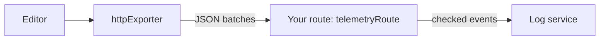

<Callout>`@docx-editor.dev/telemetry` is available in version 2.29.0 and later.</Callout>

Use this setup when you send telemetry to a log service over HTTP, such as Better Stack, Axiom, or Datadog Logs, instead of through an OpenTelemetry SDK. It has two parts:

1. In the browser, `httpExporter` batches events and posts them to a route on your own origin.
2. On your server, `telemetryRoute` checks every event again and forwards it to the log service with a token that only the server knows.



A log service token in the browser can be read by anyone and used to send any data to your account. The route keeps the token on the server, and it is same-origin, so your Content Security Policy needs no change.

## Send events from the browser

`httpExporter` posts a JSON array of events to your route. It sends a batch when `batchSize` events are waiting or `flushIntervalMs` has passed. When the page is hidden, it sends the rest with `navigator.sendBeacon`, which still delivers while the tab closes.

The following example records failures and performance, sends nothing for opens that succeed, and stops when the visitor sends Global Privacy Control or Do Not Track:

```ts
import {
  browserPrivacySignals,
  createTelemetry,
  httpExporter,
  isFailure,
} from '@docx-editor.dev/telemetry';

export const telemetry = createTelemetry({
  exporters: [httpExporter({ url: '/api/telemetry' })],
  include: {
    documentOpen: true,
    editing: true,
    trackedChanges: true,
    fonts: true,
    performance: true,
  },
  filter: (event) => isFailure(event) || event.kind === 'performance',
  consent: browserPrivacySignals({ optOutKey: 'my-app:telemetry' }),
  resource: { 'service.name': 'my-app' },
});
```

Register `telemetry.module` in the editor's `modules`, as in [Set up an editor](/docs/2.x/telemetry/editors#set-up-an-editor).

| Option | Default | What it does |
| --- | --- | --- |
| `url` | Required | The route to post to. Use a path on your own origin. |
| `batchSize` | `20` | Events per request. |
| `flushIntervalMs` | `10000` | How long an event waits for its batch to fill. |
| `headers` | None | Extra request headers. With headers, the last batch uses `fetch` with `keepalive`, because `sendBeacon` cannot send headers. |
| `onError` | None | Called when a request fails. The exporter never throws into your app. |

`filter` decides which events reach your exporters. Metrics still count every event. `browserPrivacySignals` returns a `consent` function. To combine it with your consent manager, call both: `consent: () => privacy() && consentManager.analytics`.

## Receive events on your server

`telemetryRoute` returns a Fetch-style `POST` handler for Next.js route handlers, Hono, Bun, Deno, and Cloudflare Workers. For each request, it does the following:

1. Refuses a body larger than `maxBodyBytes` (64 KiB) or an array longer than `maxEvents` (50).
2. Refuses an origin outside `allowedOrigins`, when you set it.
3. Checks every event with the same closed lists that the browser used. It drops unknown kinds and codes, removes fields outside their lists, and keeps only identifier values in `resource` and `attributes`.
4. Calls `forward` with the events that pass.

It answers `204` in every case, so a telemetry problem never shows in the editor. Use `onError` to see failures, including a log service that refuses the request. The route does not rate-limit; put it behind your platform's limits.

`toLogRecord(event)` adds the two fields that log services read, `dt` for the time and `message` for a one-line summary such as `edit.rejected edit.picture-selected`. It removes the fixed `hint` and `docs` text, which the code already identifies.

### Better Stack

In Better Stack Telemetry, create an HTTP source. Copy its source token and its ingesting host, such as `s1234567.eu-nbg-2.betterstackdata.com`, into `BETTERSTACK_SOURCE_TOKEN` and `BETTERSTACK_INGESTING_HOST`.

```ts
// app/api/telemetry/route.ts
import { telemetryRoute, toLogRecord } from '@docx-editor.dev/telemetry/ingest';

export const POST = telemetryRoute({
  allowedOrigins: ['https://app.example.com'],
  forward: (events) =>
    fetch(`https://${process.env.BETTERSTACK_INGESTING_HOST}`, {
      method: 'POST',
      headers: {
        'Content-Type': 'application/json',
        Authorization: `Bearer ${process.env.BETTERSTACK_SOURCE_TOKEN}`,
      },
      body: JSON.stringify(events.map(toLogRecord)),
    }),
  onError: (error) => console.error('[telemetry]', error),
});
```

### Axiom

Axiom reads the time from `_time`. Create a dataset and an API token with ingest access.

```ts
// app/api/telemetry/route.ts
import { telemetryRoute, toLogRecord } from '@docx-editor.dev/telemetry/ingest';

export const POST = telemetryRoute({
  forward: (events) =>
    fetch(`https://api.axiom.co/v1/datasets/${process.env.AXIOM_DATASET}/ingest`, {
      method: 'POST',
      headers: {
        'Content-Type': 'application/json',
        Authorization: `Bearer ${process.env.AXIOM_TOKEN}`,
      },
      body: JSON.stringify(
        events.map((event) => ({
          ...toLogRecord(event),
          _time: new Date(event.time).toISOString(),
        }))
      ),
    }),
});
```

### Datadog Logs

Use the logs intake for your Datadog site and an API key.

```ts
// app/api/telemetry/route.ts
import { telemetryRoute, toLogRecord } from '@docx-editor.dev/telemetry/ingest';

export const POST = telemetryRoute({
  forward: (events) =>
    fetch('https://http-intake.logs.datadoghq.com/api/v2/logs', {
      method: 'POST',
      headers: {
        'Content-Type': 'application/json',
        'DD-API-KEY': String(process.env.DD_API_KEY),
      },
      body: JSON.stringify(
        events.map((event) => ({
          ...toLogRecord(event),
          ddsource: 'docx-editor',
          service: 'my-app',
        }))
      ),
    }),
});
```

### Another server framework

If your framework does not use Fetch `Request` objects, call `validateTelemetryEvents` on the parsed body yourself. It returns the events that pass, or an empty list:

```ts
import { toLogRecord, validateTelemetryEvents } from '@docx-editor.dev/telemetry/ingest';

export function recordsFrom(body: unknown) {
  return validateTelemetryEvents(body).map(toLogRecord);
}
```

## Privacy

The route forwards only what the package's own checks allow. It never forwards free text, even if a client sends it. For every field that can be sent and the settings to review, see [Privacy](/docs/2.x/telemetry/privacy).
