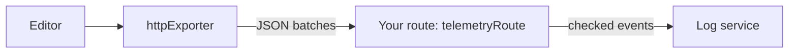

<Callout>`@docx-editor.dev/telemetry` is available in version 2.29.0 and later.</Callout>

Use this setup to send telemetry over HTTP to Better Stack, Axiom, or Datadog Logs. It has two parts:

1. In the browser, `httpExporter` batches events and posts them to a route on your own origin.
2. On your server, `telemetryRoute` validates each event and forwards it with a token that stays on the server.



Anyone can read a token in the browser and use it to send data to your log service account. The route keeps the token on the server. Requests use the same origin. Your Content Security Policy does not need to allow the external log service.

## Send events from the browser

`httpExporter` posts event batches to a route on your own origin. This example records failures and performance, and excludes successful opens. It stops collection when the browser sends Global Privacy Control or Do Not Track:

```ts
import { browserPrivacySignals, createTelemetry, httpExporter } from '@docx-editor.dev/telemetry';

export const telemetry = createTelemetry({
  exporters: [httpExporter({ url: '/api/telemetry' })],
  include: {
    documentOpen: true,
    editing: true,
    trackedChanges: true,
    fonts: true,
    performance: true,
  },
  // Everything the areas record, except opens that succeeded.
  filter: (event) => !(event.kind === 'document.open' && event.outcome === 'opened'),
  consent: browserPrivacySignals({ optOutKey: 'my-app:telemetry' }),
});
```

Register `telemetry.module` in the editor's `modules`, as in [Set up an editor](/docs/2.x/telemetry/editors).

For options, filters, and delivery when a page closes, see [HTTP exporter and route reference](/docs/2.x/telemetry/http-reference).

## Receive events on your server

`telemetryRoute` returns a Fetch-style `POST` handler for Next.js route handlers, Hono, Bun, Deno, and Cloudflare Workers. It validates each event against the same predefined values as the browser and drops browser-defined fields. It calls `forward` with valid events and returns `204` for every request.

`toLogRecord(event)` adds the `dt` and `message` fields that log services read. For validation details, see [HTTP exporter and route reference](/docs/2.x/telemetry/http-reference).

### Better Stack

In Better Stack Telemetry, create an HTTP source. Copy its source token and its ingesting host, such as `s1234567.eu-nbg-2.betterstackdata.com`, into `BETTERSTACK_SOURCE_TOKEN` and `BETTERSTACK_INGESTING_HOST`.

```ts
// app/api/telemetry/route.ts
import { telemetryRoute, toLogRecord } from '@docx-editor.dev/telemetry/ingest';

export const POST = telemetryRoute({
  allowedOrigins: ['https://app.example.com'],
  forward: (events) =>
    fetch(`https://${process.env.BETTERSTACK_INGESTING_HOST}`, {
      method: 'POST',
      headers: {
        'Content-Type': 'application/json',
        Authorization: `Bearer ${process.env.BETTERSTACK_SOURCE_TOKEN}`,
      },
      // Your fixed fields go here, on the server, where the browser cannot change them.
      body: JSON.stringify(events.map((event) => ({ ...toLogRecord(event), service: 'my-app' }))),
    }),
  onError: (error) => console.error('[telemetry]', error),
});
```

## Privacy

The route forwards predefined values, numbers, and attributes that you allow through `attributeKeys`. Allowed attribute values must be identifier strings. Session identifiers and engine versions must match the formats that the engine creates. The route never forwards text with spaces.

Validation checks event syntax. It cannot prove that an event is anonymous or that it happened. Identifier strings can still contain names, and anyone can submit a valid event. Treat event counts as browser reports. For the fields that events can contain, see [Privacy](/docs/2.x/telemetry/privacy).

## Next steps

- To send to Axiom, Datadog Logs, or from a framework without Fetch requests, see [Other log services](/docs/2.x/telemetry/log-recipes).
- For custom functions, Datadog RUM, or PostHog, see [Send to your own code](/docs/2.x/telemetry/callbacks).
