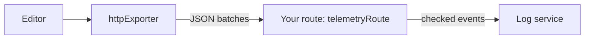

<Callout>`@docx-editor.dev/telemetry` is available in version 2.29.0 and later.</Callout>

Use this setup when you send telemetry to a log service over HTTP, such as Better Stack, Axiom, or Datadog Logs, instead of through an OpenTelemetry SDK. It has two parts:

1. In the browser, `httpExporter` batches events and posts them to a route on your own origin.
2. On your server, `telemetryRoute` checks every event again and forwards it to the log service with a token that only the server knows.



A log service token in the browser can be read by anyone and used to send any data to your account. The route keeps the token on the server, and it is same-origin, so your Content Security Policy needs no change.

## Send events from the browser

`httpExporter` posts batches of events to a route on your own origin. The following example records failures and performance, sends nothing for opens that succeed, and stops when the visitor sends Global Privacy Control or Do Not Track:

```ts
import { browserPrivacySignals, createTelemetry, httpExporter } from '@docx-editor.dev/telemetry';

export const telemetry = createTelemetry({
  exporters: [httpExporter({ url: '/api/telemetry' })],
  include: {
    documentOpen: true,
    editing: true,
    trackedChanges: true,
    fonts: true,
    performance: true,
  },
  // Everything the areas record, except opens that succeeded.
  filter: (event) => !(event.kind === 'document.open' && event.outcome === 'opened'),
  consent: browserPrivacySignals({ optOutKey: 'my-app:telemetry' }),
});
```

Register `telemetry.module` in the editor's `modules`, as in [Set up an editor](/docs/2.x/telemetry/editors).

For every option, how delivery works while a page closes, and how to write the filter, see [HTTP exporter and route reference](/docs/2.x/telemetry/http-reference).

## Receive events on your server

`telemetryRoute` returns a Fetch-style `POST` handler for Next.js route handlers, Hono, Bun, Deno, and Cloudflare Workers. It checks every event again with the closed lists the browser used, drops the fields the browser chose, and calls `forward` with the events that pass. It answers `204` to every request. `toLogRecord(event)` adds the `dt` and `message` fields that log services read. For each check, see [HTTP exporter and route reference](/docs/2.x/telemetry/http-reference).

### Better Stack

In Better Stack Telemetry, create an HTTP source. Copy its source token and its ingesting host, such as `s1234567.eu-nbg-2.betterstackdata.com`, into `BETTERSTACK_SOURCE_TOKEN` and `BETTERSTACK_INGESTING_HOST`.

```ts
// app/api/telemetry/route.ts
import { telemetryRoute, toLogRecord } from '@docx-editor.dev/telemetry/ingest';

export const POST = telemetryRoute({
  allowedOrigins: ['https://app.example.com'],
  forward: (events) =>
    fetch(`https://${process.env.BETTERSTACK_INGESTING_HOST}`, {
      method: 'POST',
      headers: {
        'Content-Type': 'application/json',
        Authorization: `Bearer ${process.env.BETTERSTACK_SOURCE_TOKEN}`,
      },
      // Your fixed fields go here, on the server, where the browser cannot change them.
      body: JSON.stringify(events.map((event) => ({ ...toLogRecord(event), service: 'my-app' }))),
    }),
  onError: (error) => console.error('[telemetry]', error),
});
```

## Privacy

The route forwards only values from the package's closed lists, numbers, and the `attributeKeys` you allow, which must be identifier strings. The session identifier and the engine version must match the formats the engine creates. The route never forwards text with spaces, even if a client sends it.

These are syntax checks. They prove that an event has the right form, not that it is anonymous or that it happened. An identifier string can still name a person if you put a name in it, and anyone can post a well-formed event, so treat the counts as reported by browsers. For every field that can be sent, see [Privacy](/docs/2.x/telemetry/privacy).

## Next steps

- To send to Axiom, Datadog Logs, or from a framework without Fetch requests, see [Other log services](/docs/2.x/telemetry/log-recipes).
- To send events to a function of your own, such as Datadog RUM or PostHog, see [Send to your own code](/docs/2.x/telemetry/callbacks).
