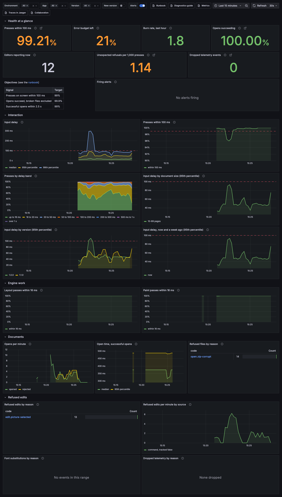
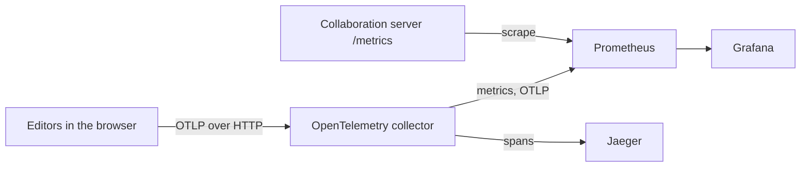

# Telemetry dashboards

A local observability stack for the telemetry examples: an OpenTelemetry collector, Prometheus, Jaeger, and Grafana with two ready dashboards, **Editor experience** and **Collaboration**.

The dashboards answer the questions a team asks about its editor: whether editing meets its objectives, how long a key press takes to reach the screen, whether a release or large documents made it slower, why files fail to open, which edits the editor refuses, and how many people each room holds. Prometheus rules record the objectives and alert when the error budget burns too fast, and each alert links to the [runbook](RUNBOOK.md).



## Run the example

1. Start the stack. It needs Docker:

   ```bash
   cd examples/telemetry-stack
   docker compose up -d
   ```

2. Start one or both editor examples. See [`telemetry-single-user`](../telemetry-single-user) and [`telemetry-collaboration`](../telemetry-collaboration).

3. Optional: fill the dashboards with simulated people. From the repository root, run:

   ```bash
   node examples/telemetry-stack/simulate.mjs 5 3
   ```

   The arguments are minutes and people per example. The script uses the repository's Playwright install.

4. Open Grafana at http://localhost:3300. It needs no sign-in. Jaeger is at http://localhost:16686.

If port 3300 is in use, set another one: `GRAFANA_PORT=3400 docker compose up -d`.

## How the data flows



## What the dashboards show

**Editor experience** opens with a health row: the share of presses within 100 ms against a 99% objective, the error budget left, the burn rate of the last hour, the share of opens that succeed, the editors that report now, unexpected refusals per 1,000 presses, dropped telemetry, and firing alerts. Rows below break input delay down by document size, release, and the week before; show engine layout and paint; and list refused files and edits by code, each linked to its hint.

**Collaboration** opens with server health: whether the server answers, the share of room stores that succeed, refused connections, client errors, and how close rooms come to their limits. Rows below show rooms and people, memory, room age, server work, client status, and refusals.

Both dashboards filter by environment, app, and version. The examples send `deployment.environment` and `app.version` as allowed metric labels; see `metricLabels` in their `src/telemetry.ts`. Annotations mark the first time a version reports and every firing alert.

## Notes for your own setup

- **Browser counters:** each tab is a short-lived source with its own totals. The example gives each tab a `service.instance.id`, and Prometheus 3 takes OTLP itself with `created-timestamp-zero-ingestion`, so a tab's first count is not lost to `increase()`. If your backend scrapes a collector instead, the first count of each tab can be missing.
- **Cardinality:** one series per tab exists while the tab sends. For many users, aggregate in your collector, or send to a backend that takes delta temporality.
- **Objectives:** the targets in `RUNBOOK.md` are starting points. The recording rules use windows up to 3 days so the local stack shows them; use 30 days in production, and validate the targets against a few weeks of your own traffic.
- **What is not measured yet:** the package counts refused edits and opens, but not edit attempts or time spent connected to a room, so edit reliability uses a proxy and collaboration has no availability objective.
- **Engine work:** layout and paint times arrive in bands of 16, 33, 50, 100, 200, 500, and 1000 ms, so percentiles interpolate inside a band.

| File | What it does |
| --- | --- |
| `docker-compose.yml` | The four services and their ports. |
| `otel-collector.yaml` | OTLP in, with CORS for local apps; metrics to Prometheus and spans to Jaeger. |
| `prometheus.yml` | The OTLP receiver settings, the rules, and the scrape of the collaboration server. |
| `rules.yml` | Recording rules for the objectives and multi-window burn-rate alerts. |
| `RUNBOOK.md` | What to check when an alert fires or a panel turns red. |
| `dashboards.py` | Generates both dashboards. Run `python3 examples/telemetry-stack/dashboards.py` after a change. |
| `grafana/dashboards/*.json` | The two dashboards. |
| `simulate.mjs` | Simulated people who type, open a broken file, and try a refused picture insert. |
| `client/` | Code both editor examples share: the event log panel, its styles, and the Vite setup. |
