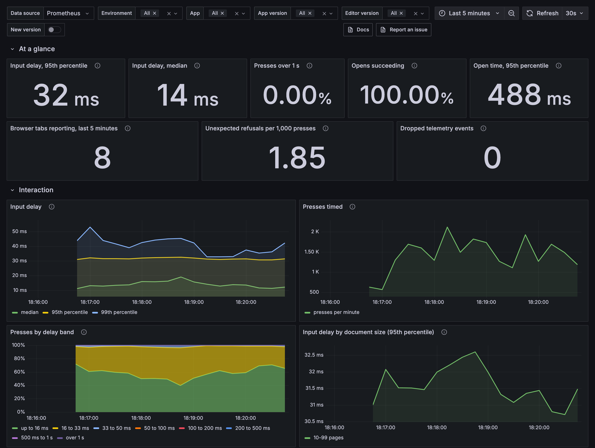
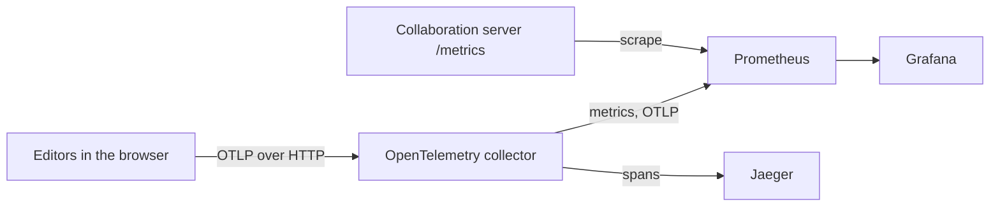
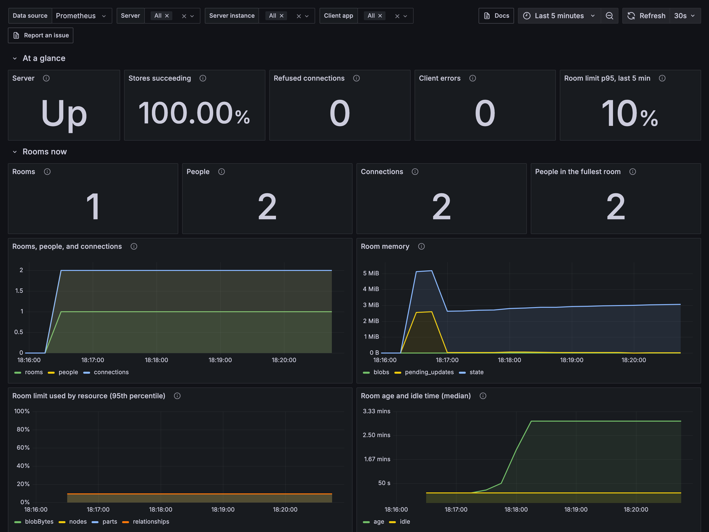

# Telemetry dashboards

A local observability stack for the telemetry examples: an OpenTelemetry collector, Prometheus, Jaeger, and Grafana with two ready dashboards, **Editor experience** and **Collaboration**.

The dashboards answer the questions a team asks about its editor: how long a key press takes to reach the screen, whether a release or large documents made it slower, why files fail to open, which tracked changes and edits the editor refuses, and how many people each room holds. They report measurements only and set no targets. The dashboards live in [`assets/observability`](../../assets/observability), the files you import into your own Grafana; this stack mounts them from there.



To download the dashboards for your own Grafana, see [`assets/observability`](../../assets/observability) or [Dashboards](https://docx-editor.dev/docs/2.x/telemetry/dashboards) in the docs.

## Run the example

1. Start the stack. It needs Docker:

   ```bash
   cd examples/telemetry-stack
   docker compose up -d
   ```

2. Start one or both editor examples. See [`telemetry-single-user`](../telemetry-single-user) and [`telemetry-collaboration`](../telemetry-collaboration).

3. Optional: fill the dashboards with simulated people. From the repository root, run:

   ```bash
   node examples/telemetry-stack/simulate.mjs 5 2
   ```

   The arguments are minutes and people per example. Each person is a headless browser on your machine, so many people load the CPU, and the dashboards show that load as input delay. The script uses the repository's Playwright install.

4. Open Grafana at http://localhost:3300. It needs no sign-in. Jaeger is at http://localhost:16686.

If port 3300 is in use, set another one: `GRAFANA_PORT=3400 docker compose up -d`.

## How the data flows



## What the dashboards show

**Editor experience** opens with the input delay median and 95th percentile, the share of presses over 1 second, the share of opens that succeed, the open time, the browser tabs that report, unexpected refusals per 1,000 presses, and dropped telemetry. Rows below show input delay over time and by document size, app version, editor version, and the week before; engine layout and paint time; opens; refused tracked changes and skipped tracked changes; and all refused edits, each code linked to its hint.

**Collaboration** opens with server state: whether the server answers, the share of room stores that succeed, refused connections, client errors, and how much of the room limits is in use. Rows below show rooms and people, memory, room age, server work, client status, and refusals.



**Editor experience** filters by environment, app, app version, and editor version. The examples send `deployment.environment` and `app.version` as allowed metric labels; see `metricLabels` in their `src/telemetry.ts`. Every editor metric carries `docx_editor_version` by itself. **Collaboration** filters by server, server instance, and client app. A **New version** annotation, off by default, marks the first time an app version reports.

## Notes for your own setup

- **Browser counters:** each tab is a short-lived source with its own totals. The example gives each tab a `service.instance.id`, and Prometheus 3 takes OTLP itself with `created-timestamp-zero-ingestion`, so a tab's first count is not lost to `increase()`. If your backend scrapes a collector instead, the first count of each tab can be missing.
- **Cardinality:** one series per tab exists while the tab sends. For many users, aggregate in your collector, or send to a backend that takes delta temporality.
- **Targets:** the dashboards report data and set no targets. Decide what is acceptable from a few weeks of your own traffic, then decide what to alert on.
- **What is not measured yet:** the package counts refused edits and opens, but not edit attempts or time spent connected to a room, so edit reliability uses refusals per 1,000 presses and collaboration has no availability measure.
- **Engine work:** layout and paint times arrive in bands of 16, 33, 50, 100, 200, 500, and 1000 ms, so percentiles interpolate inside a band.

| File | What it does |
| --- | --- |
| `docker-compose.yml` | The four services and their ports. |
| `otel-collector.yaml` | OTLP in, with CORS for local apps; metrics to Prometheus and spans to Jaeger. |
| `prometheus.yml` | The OTLP receiver settings and the scrape of the collaboration server. |
| `grafana/provisioning/` | Loads the dashboards from `assets/observability/grafana` and adds the Prometheus and Jaeger data sources. |
| `simulate.mjs` | Simulated people who type, open a broken file, and try a refused picture insert. |
| `client/` | Code both editor examples share: the event log panel, its styles, and the Vite setup. |
