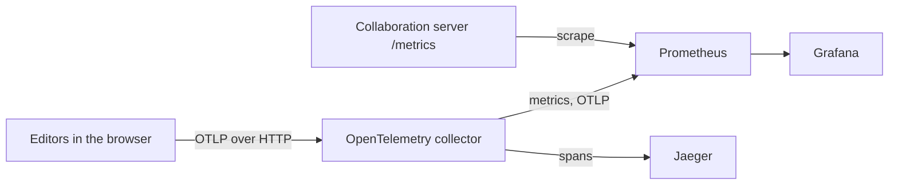

# Telemetry dashboards

This example runs an OpenTelemetry collector, Prometheus, Jaeger, and Grafana locally. Grafana includes the **Editor experience** and **Collaboration** dashboards.

Use the dashboards to investigate input delay, failed document opens, refused edits, and collaboration server capacity. Compare performance across releases and document sizes. The dashboards report measurements without setting targets. This example loads the dashboard files from [`assets/observability`](../../assets/observability). You can import the same files into your own Grafana instance.


For download and setup instructions, see [Dashboards](https://docx-editor.dev/docs/2.x/telemetry/dashboards).

## Run the example

1. Start the stack. It needs Docker:

   ```bash
   cd examples/telemetry-stack
   docker compose up -d
   ```

2. Start one or both editor examples. See [`telemetry-single-user`](../telemetry-single-user) and [`telemetry-collaboration`](../telemetry-collaboration).

3. Optional: generate dashboard data with simulated editor sessions. From the repository root, run:

   ```bash
   node examples/telemetry-stack/simulate.mjs 5 2
   ```

   The arguments specify minutes and participants per example. Each participant uses a headless browser on your machine. More browsers increase CPU load, which can increase the reported input delay. The script uses the repository's Playwright installation.

4. Open [Grafana](http://localhost:3300) or [Jaeger](http://localhost:16686). Grafana requires no sign-in.

If port 3300 is in use, set another one: `GRAFANA_PORT=3400 docker compose up -d`.

## How the data flows



## What the dashboards show

**Editor experience** shows input delay, document open success rates, open times, reporting sources, unexpected refusals, and dropped telemetry. A sessions row shows sessions started, active editing time, session length, the share of failing edits, save success and save time, and people editing at once. It includes median and 95th percentile input delay, plus the share of key presses over 1 second. Unexpected refusals use a rate per 1,000 key presses. Detailed charts compare input delay over time, across document sizes and versions, and against the previous week. Other panels show layout and paint times, document opens, refused and skipped tracked changes, and refused edits. Each refusal code links to its hint.

**Collaboration** shows server availability, room save success rates, refused connections, client errors, and room limit usage. Detailed charts show room and participant counts, memory use, room age, server operations, client status, and refusals.


**Editor experience** filters by environment, app, app version, and editor version. The examples send `deployment.environment` and `app.version` as allowed metric labels; see `metricLabels` in their `src/telemetry.ts`. The package adds `docx_editor_version` to every editor metric. **Collaboration** filters by server, server instance, and client app. The optional **Version started reporting** annotation marks versions that report after at least 2 minutes without data. This can indicate a release or resumed reporting.

## Notes for your own setup

- Browser counters: each tab is a temporary source with its own totals and `service.instance.id`. Prometheus 3 receives OpenTelemetry Protocol (OTLP) data directly with `created-timestamp-zero-ingestion` enabled. This preserves each tab's first count in `increase()`. If your backend scrapes a collector, it can miss that first count.
- Series count: each reporting tab creates a series. For many users, aggregate in your collector or use a backend that accepts delta temporality.
- Targets: use several weeks of your own traffic to set performance targets and alert thresholds.
- Measurement limits: the package counts edits, refused edits, opens, saves, and editor sessions. It does not measure time spent connected to a room, so collaboration has no measure of client connection availability. Edit and session counts arrive with session summaries, up to a minute after the edit.
- Engine work: layout and paint times use bands of 16, 33, 50, 100, 200, 500, and 1000 ms. Percentiles estimate values within each band.

| File | What it does |
| --- | --- |
| `docker-compose.yml` | The four services and their ports. |
| `otel-collector.yaml` | OTLP in, with CORS for local apps; metrics to Prometheus and spans to Jaeger. |
| `prometheus.yml` | The OTLP receiver settings and the scrape of the collaboration server. |
| `grafana/provisioning/` | Loads the dashboards from `assets/observability/grafana` and adds the Prometheus and Jaeger data sources. |
| `simulate.mjs` | Simulates typing, saving, opening an invalid file, and attempting a refused picture insert. |
| `client/` | Code both editor examples share: the event log panel, its styles, and the Vite setup. |
